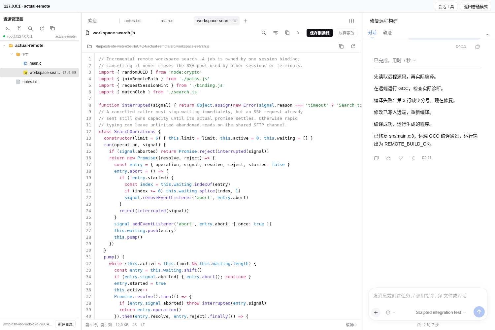
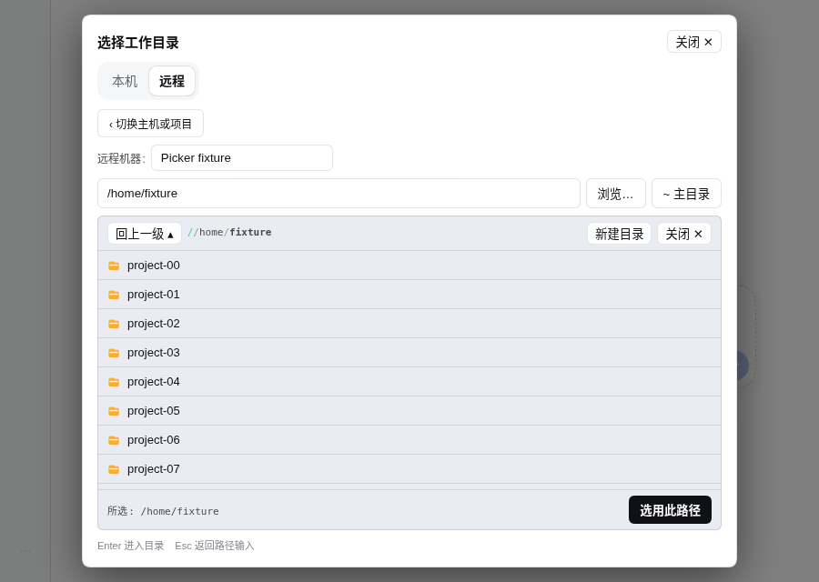
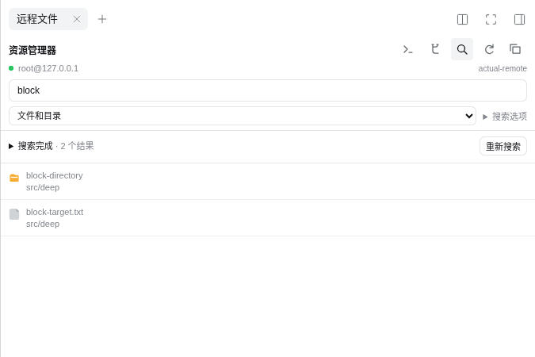
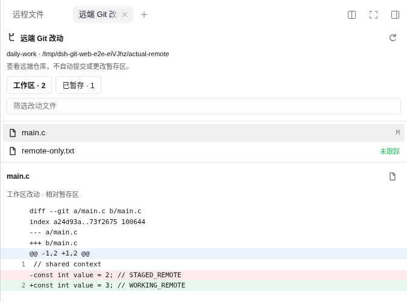
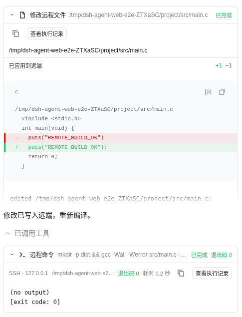

**English** · [中文](https://github.com/flymysql/dsh-remote/blob/main/README.md)

# dsh-remote

[](https://www.npmjs.com/package/dsh-remote)
[](https://www.npmjs.com/package/dsh-remote)
[](https://www.npmjs.com/package/dsh-remote)
[](https://github.com/flymysql/dsh-remote/blob/main/LICENSE)
[](https://github.com/topics/dsh-plugin)

Maintained by [@flymysql](https://github.com/flymysql) · [Homepage](https://flymysql.github.io/dsh-remote/) · [Usage stats](https://flymysql.github.io/dsh-remote/stats/) · [Blog](https://gitpull.cn) · [Discussions](https://github.com/flymysql/dsh-remote/discussions) · [Issues](https://github.com/flymysql/dsh-remote/issues) · [中文说明](https://github.com/flymysql/dsh-remote/blob/main/README.md)

Turn SSH hosts into everyday development workspaces in [DeepSeek Harness](https://github.com/deepseek-ai/deepseek-harness): browse remote files, edit code, run terminals and let the agent work on the same remote project. Multiple workspaces can use different hosts in parallel.

**IDE mode: files on the left, editor in the center, native agent conversation on the right.** Resize columns or switch panes on narrow screens. Returning to the normal layout keeps tasks and unsaved edits.



## Install

```bash
dsh plugin --profile web add dsh-remote
```

After installation or an upgrade, restart DSH Web and refresh the page. Check automatic-update status under Settings → Remote workspaces → Preferences.

## Start in 3 steps

1. **Configure a host**: open Settings → Remote workspaces to edit SSH configuration or save credentials. Connectivity checks run automatically; no manual connection step is required.
2. **Create a workspace**: Add workspace → Remote, then choose a host and folder. Each workspace binds its own host; settings have no folder selection or global active host.
3. **Develop remotely**: open workspace files or enter IDE mode to edit, search, run commands and collaborate with the agent.



## Everyday development

### Search remote names and contents

Find files, directories or content recursively without expanding folders or syncing a mirror first. The default view keeps scope and progress compact; expand search options or scan details when needed. Case sensitivity, ignored directories, stop and retry remain available. Results reveal a directory or open the matching file line.



### Inspect remote Git changes

Switch between working-tree and staged diffs, filter files and jump from a changed line to source. The panel is read-only; it does not commit or change the index.



### Run a remote terminal

The terminal starts in the session's remote directory. A pixel fish welcomes you before the real SSH shell; saved credentials can answer authentication automatically, and multiple terminals can run together.


### Edit and build with the agent

Tool cards show applied changes, actual exit codes and build output, with compiler diagnostics linking to source. Saving detects remote conflicts, preserves CRLF and protects newer input typed during the save.



## Compatibility and limits

- Primarily targets **DSH Web 0.2.x**; 0.2.2 needs **Node.js ≥24.9**. See the [compatibility reference](https://github.com/flymysql/dsh-remote/blob/main/docs/reference.en.md#dsh-version-compatibility) for older-host fallbacks, Desktop/TUI and agent-diff differences.
- Files access the remote host directly; mirrors sync on demand. Drafts live in page memory and can be lost after a crash or forced exit.
- No remote language server, extension host or debugger. The agent runs commands as your configured SSH user; configure trusted hosts only.

## Documentation and community

[Full tool and configuration reference](https://github.com/flymysql/dsh-remote/blob/main/docs/reference.en.md) · [Troubleshooting](https://github.com/flymysql/dsh-remote/blob/main/docs/troubleshooting.md) · [Upgrade guide](https://github.com/flymysql/dsh-remote/blob/main/docs/migration-1.0.md) · [Changelog](https://github.com/flymysql/dsh-remote/blob/main/CHANGELOG.md)

[Homepage](https://flymysql.github.io/dsh-remote/) · [Discussions](https://github.com/flymysql/dsh-remote/discussions) · [Report an issue](https://github.com/flymysql/dsh-remote/issues) · [Contributing](https://github.com/flymysql/dsh-remote/blob/main/CONTRIBUTING.md) · [Contributors and credits](#contributors-and-credits)

Maintained by [@flymysql](https://github.com/flymysql) and the community · [MIT](https://github.com/flymysql/dsh-remote/blob/main/LICENSE)

### Contributors and credits

Thanks to everyone who makes this project better (avatars link to profiles; bots excluded):

<p align="left">
  <a href="https://github.com/flymysql"></a>
  <a href="https://github.com/baiseraku"></a>
  <a href="https://github.com/glzhangzhi"></a>
  <a href="https://github.com/hjwsm1989"></a>
  <a href="https://github.com/j10ha0"></a>
  <a href="https://github.com/FoolishWiser"></a>
  <a href="https://github.com/kakaa-nju"></a>
  <a href="https://github.com/4FMTWRV"></a>
  <a href="https://github.com/dahaipeng"></a>
  <a href="https://github.com/davidlin2k"></a>
  <a href="https://github.com/FlintyLemming"></a>
  <a href="https://github.com/GDWhisper"></a>
  <a href="https://github.com/YiHui-Liu"></a>
  <a href="https://github.com/Minggle"></a>
  <a href="https://github.com/nekomona"></a>
  <a href="https://github.com/shis23"></a>
</p>

<details>
<summary>Contribution highlights and earlier contributors</summary>

Recent highlight contributions (there is always room on this list):

| Contributor | What they did |
| --- | --- |
| [@baiseraku](https://github.com/baiseraku) | the whole dsh-tui adaptation layer ([#92](https://github.com/flymysql/dsh-remote/pull/92)) + the status-bar fix ([#98](https://github.com/flymysql/dsh-remote/pull/98)) |
| [@hjwsm1989](https://github.com/hjwsm1989) | both remote-.md renderer fixes: the memo guard ([#102](https://github.com/flymysql/dsh-remote/pull/102)) and the labels contract ([#107](https://github.com/flymysql/dsh-remote/pull/107)) |
| [@shis23](https://github.com/shis23) | rw_sync path-mapping fix + SFTP timeout resilience ([#105](https://github.com/flymysql/dsh-remote/pull/105)) |
| [@davidlin2k](https://github.com/davidlin2k) | dialing credential-less machines through the user's own ssh ([#100](https://github.com/flymysql/dsh-remote/pull/100)) |
| [@GDWhisper](https://github.com/GDWhisper) | the per-keystroke completion reconnect fix ([#42](https://github.com/flymysql/dsh-remote/pull/42), issue #41) |
| [@glzhangzhi](https://github.com/glzhangzhi) | the per-session SSH pool isolation behind issue #25 |

The older hand-kept roll of merged PRs (with their numbers):


[@dahaipeng](https://github.com/dahaipeng) (#31) ·
[@YiHui-Liu](https://github.com/YiHui-Liu) (#28) ·
[@nekomona](https://github.com/nekomona) (#24) ·
[@zhz1667](https://github.com/zhz1667) (#43) ·
[FoolishWiser](https://github.com/FoolishWiser) (#17) ·
[@jace1cch](https://github.com/jace1cch) (#16) ·
[@Minggle](https://github.com/Minggle) (#10) ·
[4FMTWRV](https://github.com/4FMTWRV) (#6) ·
[glzhangzhi](https://github.com/glzhangzhi) (per-session SSH pool fix)

> The wall updates with releases; a well-written issue report, a repro, or a root-cause lead
> is worth as much as a patch — about half of this repo's fixes started as a clear issue.

</details>
