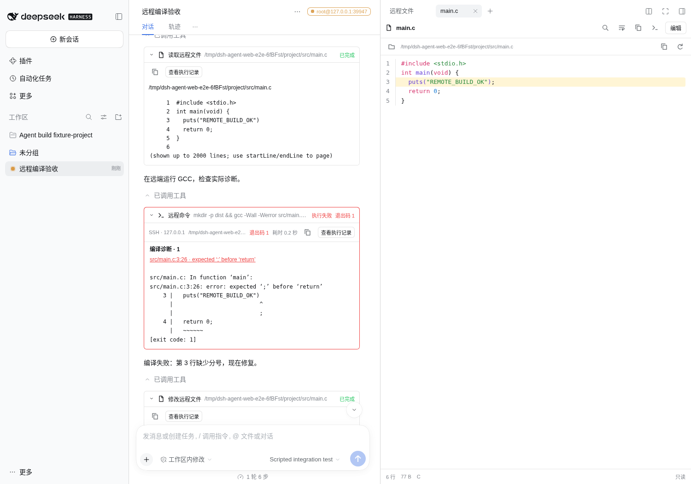
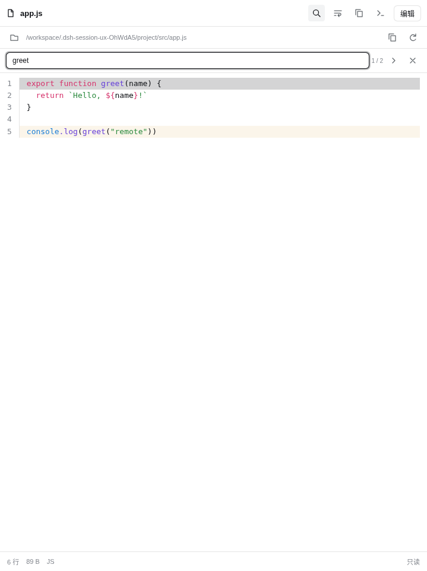
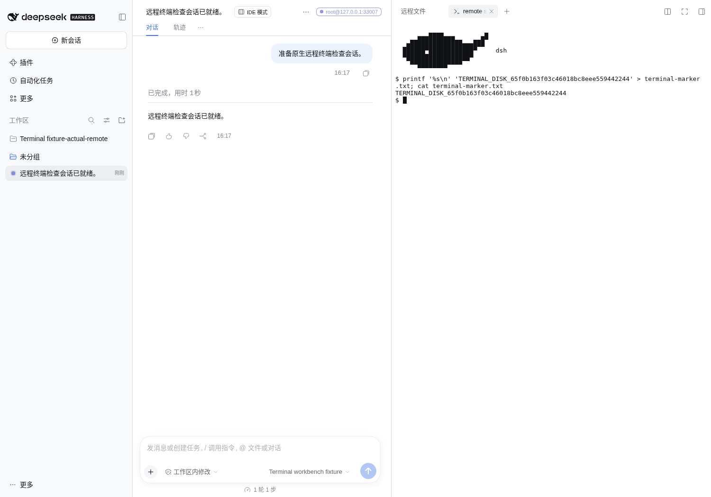

**English** · [中文](https://github.com/flymysql/dsh-remote/blob/main/README.md)

---

# dsh-remote

[](https://www.npmjs.com/package/dsh-remote)
[](https://www.npmjs.com/package/dsh-remote)
[](https://www.npmjs.com/package/dsh-remote)
[](https://github.com/flymysql/dsh-remote/blob/main/LICENSE)
[](https://github.com/topics/dsh-plugin)

Maintained by [@flymysql](https://github.com/flymysql) · [Homepage](https://flymysql.github.io/dsh-remote/) · [Usage stats](https://flymysql.github.io/dsh-remote/stats/) · [Blog](https://gitpull.cn) · [Discussions](https://github.com/flymysql/dsh-remote/discussions) · [Issues](https://github.com/flymysql/dsh-remote/issues) · [中文说明](https://github.com/flymysql/dsh-remote/blob/main/README.md)


**Remote-work assistant for [DeepSeek Harness](https://github.com/deepseek-ai/deepseek-harness) (DSH).**

Manage several SSH machines, then pick a **remote workspace** (or a **local** one) and let the agent operate right there without leaving the harness — listing files, reading code, running builds & commands over the remote host, and keeping that remote directory mirrored into a real local workspace object.

The harness Web UI intentionally binds `127.0.0.1` (the CLI rejects `--host 0.0.0.0` for safety). This plugin goes the other way: **you connect out** to the machines you maintain, pick a workspace, and work in it through the normal DSH workspace + agent fs flows — no changes to `dsh-workspace` or the harness core.

It works the other way too: **you can open the remote machine's own DSH Web UI as a page in your local browser** — again without exposing any port on the remote. The remote dsh must be installed by you (the plugin no longer installs it).

## 1.0 workspace experience

Search and reopen recent remote projects directly. The explorer keeps session context and files use native tabs. Agent command cards show actual exit codes, duration and compiler diagnostics; a diagnostic opens the remote file at the reported line. Files support search, wrapping, Markdown preview and save shortcuts. Reopening a file revalidates changes made by the agent.

Unsaved drafts remain in page memory, with an unload warning; browser crashes or forced termination can still lose them. The file pane accesses the remote host directly. Mirrors update through `rw_sync` / `rw_push`, or explicitly enabled autoPush. A completed sync describes that operation, not continuous equality.

The new interface primarily targets DSH Web 0.2.x; DSH 0.2.2 requires Node.js ≥24.9. Older hosts use the available fallback interfaces. This plugin does not provide a remote language server, extension host, or hosted remote Git/debugger.


---

## Screen previews

**Agent diagnostics and remote source navigation** — inspect actual exit codes and open the reported remote file line:



**File viewing and search** — line numbers, syntax highlighting, match navigation and wrapping:



**Native remote terminal** — explicitly launch remote ssh in the current session's remote directory:



## Features


The image above is the overview. What follows is only what the image does not make obvious.

**Workspace picker** (fills the native "Add workspace" flow) — Local uses the system folder chooser; Remote browses inside the modal:


- The path field autocompletes live; on Windows hosts the root shows a multi-drive view; the floating browser fills the field without committing.
- On confirm a **real local mirror** is created and adopted by the harness, kept in sync over SFTP; the choice persists on the machine.

**Settings** — independent host connectivity checks and connection-test duration, with host configuration separate from workspace creation:


The rest:

- **21 model tools** (listed so they can be copied or searched): `rw_info`, `rw_connect`, `rw_machines`, `rw_pick_workspace`, `rw_list_dir`, `rw_stat`, `rw_read_file`, `rw_write_file`, `rw_edit`, `rw_append`, `rw_mkdir`, `rw_remove`, `rw_move`, `rw_exec`, `rw_search`, `rw_download`, `rw_upload`, `rw_sync`, `rw_push`, `rw_forward`, `rw_disconnect`.
- **Tell local and remote Sessions apart in the sidebar** (`0.8.43+`) — a remote Session row carries a **green dot** and its hover card names `user@host:port` plus the remote path; opening it also shows a host chip in the conversation header (a local Session shows neither). A Session counts as remote only when its cwd sits inside a `$DSH_HOME/remote-workspaces/…` mirror, so a machine that is merely saved never labels a local Session.
- **A terminal in a remote Session opens on the remote host out of the box** (`0.8.75+`) — the shell menu's **remote ssh** entry routes by cwd (a mirror cwd → ssh into the remote workspace; anything else → transparent local-shell fallback), and it is the **default shell** whenever neither the host nor you picked one. Saved passwords are answered through the local credential bridge (`0.8.81+`, including OS-keychain ones) — no more `password:` prompt every time a terminal opens.
- **Remote file previews have line numbers and syntax highlighting** (`0.8.86+`) — code files render through the host's own Shiki engine, and chat links carrying `file:line` (or `#L<n>`) land on that line with a flash.
- **Remote project skills need no prior sync** (issue #120) — `.dsh/skills` and `.agents/skills` on a remote workspace appear in the DSH skill catalog, including directory bundles and top-level Markdown files; full bodies load over SFTP on demand, and the remote candidate wins a same-named stale mirror copy. Resolve adjacent resources with `rw_list_dir` / `rw_read_file`. Writes, pushes and autoPush invalidate the catalog immediately; background/external edits are covered by a five-minute **invalidate-only** timer that performs no SFTP traffic of its own. Ordinary local Sessions keep the host's original skill discovery.
- **Open a remote machine's DSH Web UI locally** (`0.8.36+`) — nothing has to be exposed on the remote: the plugin SSHes out, starts a `dsh web` there that binds **`127.0.0.1` only**, and tunnels its port back to a loopback port on this machine. The URL carries a one-time login token, consumed once by a redirect.
- **The audit log opens locally** — preview recent entries in the panel, or use 「打开日志文件」/「在文件夹中显示」 to open the log with a local program (the log lives on the DSH host, so a browser cannot open it).
- **Cross-platform remotes** — all file access is SFTP-protocol-level (no POSIX shell), so Linux/macOS/Windows remotes all work.
- **Windows remotes** — the platform is auto-detected and commands go through `bash -s` over stdin, so quoting and backslash escaping are never an issue (`config.shell` can pin a path or `native` disables wrapping); `C:\Users\dev` and `/c/Users/dev` are both accepted.
- **Async long tasks** — `rw_sync`/`rw_push` with `async: true` return a `taskId` with progress/result/cancel.
- **Data lives under the harness home** — machines and mirrors follow `$DSH_HOME`; pre-0.6 data migrates automatically on first run.
- **No `dsh-workspace` core changes** — everything ships as a normal plugin.
- **Pages in the terminal UI too (dsh-tui)** — `/dsh-remote` opens a server management page (add/edit/delete, connect, browse remote directories; press `w` there to set the current directory as a workspace), and the new-workspace picker can list remote project directories directly — again without patching dsh-tui. See "Use it from the TUI" below.

## Install

### DSH version compatibility

Runs on **both** the `0.1.x` and `0.2.x` DSH lines. DSH validates every `@deepseek-ai/dsh-*` peer range *before* importing a bundle and **drops the whole bundle** when any range does not match (no settings panel, no `rw_*` tools):

```
dsh: skipping profile bundle "dsh-remote": Error: Plugin dsh-remote@… is incompatible …
```

A caret on `0.x` is locked to that minor line (`^0.1.x` cannot admit `0.2.x`, and vice versa), so since **0.8.29** the ranges are cross-line intervals: `>=0.1.0-rc.6 <0.3.0`. Version 1.0 also declares explicit prerelease ranges for normal npm installs on 0.1.5, 0.1.7, 0.2.0 and 0.2.2 RC hosts. **If you are below 0.8.29, upgrade the plugin before you upgrade DSH.**

### Official Desktop compatibility (experimental)

A compatibility path for the [official DeepSeek Harness Desktop](https://github.com/deepseek-ai/deepseek-harness), tested against the `0.1.5-rc.2` Host transport; it does not replace the harness core or require a listening Web server:

- SSH settings and the directory picker use `/api/dsh-remote/*` over the Desktop's `dsh-app:` carrier (registered on `ctx.connection.fetch`).
- A native Remote Files entry uses `sidebarRightTabs`, giving remote files session-scoped resource addresses instead of sending remote paths to the local Files viewer.
- `dsh-better-sidebar` is not bundled; official Desktop uses the native right sidebar.

Verified: host startup, IPC requests, real SSH read-only connect/list/read, and per-session routing (sidebar `/ls` `/read` `/write` `/fs` with `sessionId`). The native file-tab GUI, failed/cancelled dialogs and non-macOS hosts remain experimental. The Desktop installer may need an explicit policy for the optional `ssh2` / `cpu-features` build scripts.

### Published Web bundle

```bash
dsh plugin add dsh-remote
```

Since **v0.8.18** it installs and mounts only itself; the Web sidebar ([dsh-better-sidebar](https://www.npmjs.com/package/dsh-better-sidebar)) is optional. DSH Web hosts with the native sidebar already have a remote file explorer/editor; better-sidebar is an optional alternative.

> **Upgrading from 0.7.2–0.8.17:** the embedded sidebar goes away; any old profile override for `id: dsh-remote-sidebar` can be removed.

(or `npm install dsh-remote` + add `- id: dsh-remote / name: dsh-remote` in `cordis.patch.yml`).

## Quick start

1. **Configure hosts** — Settings → Remote workspaces lists SSH config entries and saved hosts. Opening the page automatically checks SSH connectivity and shows connection-test duration. Checks do not select a host, open a folder or change any workspace. Add Host blocks with **Edit SSH config**, then **Refresh**. Saved hosts provide credential and connection editing through their actions menu.
2. **Create a remote workspace** — use the sidebar Add workspace flow, choose a host and remote folder, or reopen a recent project. Confirmation creates or reuses the local mirror and opens it through the host. Each workspace binds its own host, so multiple remote hosts work in parallel; settings have no global active-host selector. Local projects use the system folder chooser or built-in browser.
3. **Work with the agent** — treat it like any workspace: `rw_read_file` / `rw_write_file` / `rw_edit` / `rw_exec` / `rw_search` / `rw_sync` / `rw_push` / `rw_forward` (full list above).

> **Remote context is session-scoped:** the "Remote workspace" system-prompt section appears only when the current session's workspace is a remote mirror; local sessions are unaffected and the model will not call `rw_*` on its own.

## Open a remote machine's DSH Web UI locally

The `dsh web` running on a remote machine can also be opened **as a page on this machine** (issue #46). The direction stays "this machine dials out":

> **The remote opens no port.** DSH deliberately refuses `--host 0.0.0.0` (it would put remote
> code execution on the network), so the correct shape is: SSH out, start a `dsh web` on the remote
> that listens on **127.0.0.1 only**, and carry its port back over the SSH connection to a loopback
> port here.

Usage: Settings → Remote workspaces → **"Remote DSH Web UI"** → pick a machine → **Connect & open**.
A new tab opens showing that remote machine's full DSH interface (chat, tool tree, settings).

- The URL looks like `http://127.0.0.1:3088/?token=…`. That token is a one-time credential the remote
  process prints at startup and is used once, on this machine, by that redirect: DSH exchanges it for a
  30-day signed cookie and lands on a clean `/`. **Do not share that tokenized URL.**
- "Disconnect" only closes the tunnel and deliberately does **not** kill the remote process (it may be
  an instance you use elsewhere). "Disconnect & stop remote" also ends the process — but only one this
  plugin started.
- If the remote already runs an interface (for example one you started in a terminal), pick the machine
  and paste its `http://127.0.0.1:<port>/?token=…` into the field, then "Attach to running instance" —
  no second instance will be started.
- For a **boot-start / resident remote DSH**, manual pasting is unnecessary: configure
  `webAttachDiscoverCommand` on the machine card → "Advanced" → "Discover command" (per machine only;
  empty keeps the historical always-spawn behaviour). Before "Connect & open", the plugin runs this command
  on the remote and takes the last `http(s)://…` line with a valid port and token. If that address answers
  a health probe, the resident instance is reused: no second process is spawned, and disconnect never stops
  it. Empty output, a failing command, an 8-second timeout, or a failed health probe all fall back to the
  normal launch, with the reason shown in the UI. Raw discovery output and its token never enter the audit log.

  Have the resident instance's startup script save its launch URL in `$HOME/.dsh-web-url` (on Windows,
  `%USERPROFILE%\.dsh-web-url`). The file contains one line, `http://127.0.0.1:<port>/?token=…`; then use
  the command appropriate for that remote:

  ```bash
  # Linux / macOS (sh / bash)
  cat "$HOME/.dsh-web-url" 2>/dev/null

  # Windows remote (PowerShell; works with cmd or PowerShell as the SSH login shell)
  powershell -NoProfile -Command "Get-Content $env:USERPROFILE\.dsh-web-url -ErrorAction SilentlyContinue"
  ```

  The discover command runs verbatim in the remote **login shell** — the plugin does not rewrite it as a
  POSIX command — so Windows remotes can use PowerShell directly. A missing file produces empty output and
  the plugin starts a fresh instance as before.
- When the remote `dsh` is not on the SSH login PATH, point `webAttachCommand` at its absolute path; to
  keep an attached instance out of the remote user's own sessions and settings, point `webAttachDshHome`
  at a scratch directory. This is **per machine**: Settings → Remote workspace → the machine card →
  expand "Advanced" → "Remote dsh command" (e.g.
  `/home/you/.nvm/versions/node/v22.19.0/bin/node /home/you/.dsh-remote/dsh/node_modules/@deepseek-ai/dsh/lib/bin.js`).
  Empty falls back to the global `webAttachCommand`.
- The tunnel follows the SSH connection: when it drops, the UI shows "Disconnected" and the local DSH
  process is **not** affected. After the pool reconnects the plugin re-resolves the remote port (restarting
  the remote process it started, if that one died), so hitting "Reconnect" is enough to carry on.
- The remote node must be **≥ 20.12** (booting dsh needs `parseEnv` from `node:util`, which only exists
  from 20.12). On an older node npm only warns (EBADENGINE) and installs anyway, and the crash arrives
  later as `does not provide an export named 'parseEnv'` — check the version before you install.

## Use it from the TUI (dsh-tui)

The plugin ships a TUI adaptation layer: once installed into a `dsh-tui` profile, the same
machine registry, SSH pool and remote workspaces work in the terminal UI — **without patching
dsh-tui itself** (everything registers through its plugin seams).

```bash
# On a machine that already runs dsh-tui this is the only step; a local checkout works too
dsh plugin --profile dsh-tui add dsh-remote
# or: dsh plugin --profile dsh-tui add /path/to/dsh-remote
```

Restart dsh-tui afterwards. What you get:

- `/dsh-remote` — a full-screen server page (add/edit/delete, connect, probe, browse, set-as-workspace, cleanup);
- the `/workspace` picker lists remote projects directly (or go straight: `dshremote://<machine>/<path>`);
- the status bar names the current remote machine (remote Sessions only; hover for details).

Web profiles are unaffected: without the terminal seams the layer stays off, silently. Keymap,
cleanup semantics, the host-API contract and the limits live in **[docs/tui.md](https://raw.githubusercontent.com/flymysql/dsh-remote/main/docs/tui.md)** (Chinese).

## CLI defaults (optional)

Provide a default machine in `cordis.patch.yml`:

```yaml
# Example only — use values for your own machine.
- id: dsh-remote
  name: dsh-remote
  config:
    host: 203.0.113.10   # or your real host / hostname
    port: 22
    username: dev
    privateKeyPath: ~/.ssh/id_rsa
    # or password: '…'
    workspace: ~/project
```

If `host` is empty the plugin starts disconnected and you configure machines in the UI.

## CLI quick reference

Installing and driving DSH may live in different shells, so both the `dsh` binary and the `npx` form are shown. Always tell DSH **which profile** to use with `--profile <name>` (usually `web`).

```bash
# install the bundle into a profile (npm is pulled by pnpm; recommended)
dsh plugin --profile web add dsh-remote
# same but when `dsh` is not on PATH (e.g. Windows PowerShell inside a repo)
npx --yes @deepseek-ai/dsh plugin --profile web add dsh-remote

# confirm it is installed wire
dsh plugin --profile web list
npx --yes @deepseek-ai/dsh plugin --profile web list

# start the web surface (reload profile; the plugin activates on boot)
dsh --profile web
npx --yes @deepseek-ai/dsh --profile web   # http://127.0.0.1:3080

# use a local checkout instead of the npm version (dev iteration)
npx --yes @deepseek-ai/dsh plugin --profile web add /path/to/dsh-remote
npx --yes @deepseek-ai/dsh plugin --profile web remove dsh-remote   # back to release
```

After a successful start, `Settings → 远程工作区` appears and the "Add workspace" flow gains the 本机 / 远程 tabs (screenshots above).

## Development (sandbox, not product)

Iterate in the sandbox — hand-editing a product profile is reverted by the plugin manager on reinstall:

```bash
scripts/dev-run.sh --restart   # start / restart the isolated sandbox
scripts/dev-run.sh --stop      # stop it
scripts/dev-run.sh --status    # is it running?
```

- The sandbox runs its own DSH instance (`dev-harness/harness`), serving on `http://127.0.0.1:50599`.
- **Host-half** (`lib/index.js`) changes need `--restart`; **client-half** (`lib/client.js`) changes need only a page refresh.
- The script hardlink-copies `lib/` into the sandbox rather than symlinking — a symlink breaks `@deepseek-ai/*` resolution.
- Before committing: `node check.mjs` (framework-constraint gate) and `npm test`; `scripts/boot-smoke.sh` proves the plugin still starts.
- Full rules live in `scripts/dev-standards.md`.

Deploying to a product profile is a separate, explicit action (`./sync.sh`) for releases only.

## Configuration

| Key | Type | Default | Meaning |
| --- | --- | --- | --- |
| `host` | string | `''` | default SSH host (else start disconnected) |
| `port` | int | `22` | default SSH port |
| `username` | string | `''` | default SSH user |
| `password` | string | `''` | default SSH password (non-empty overrides key) |
| `privateKeyPath` | string | `''` | private key path (used only when explicitly provided) |
| `passphrase` | string | `''` | passphrase for an encrypted private key |
| `workspace` | string | `''` | default remote workspace path |
| `shell` | string | `''` | remote command terminal strategy: `''`=auto-detect (Git Bash on Windows remotes), `'git-bash'`=prefer Git Bash, `'native'`=never wrap, anything else=explicit bash.exe path (e.g. `C:\Program Files\Git\bin\bash.exe`) |
| `commandTimeoutMs` | int | 20000 | per remote command timeout |
| `connectTimeoutMs` | int | 15000 | SSH connect timeout |
| `maxOutputChars` | int | 200000 | cap on captured stdout/stderr per remote command |
| `maxFileBytes` | int | 52428800 | skip mirroring/reading files larger than this (0 = no cap) |
| `hostKeyMode` | string | `accept-new` | host-key policy: `accept-new` (TOFU), `verify` (reject unknown hosts), `off` (skip) |
| `useAgent` | bool | `false` | authenticate via the OpenSSH agent (`SSH_AUTH_SOCK`) |
| `keyboardInteractive` | bool | `false` | allow keyboard-interactive auth (OTP/MFA) with the configured password |
| `backend` | string | `native` | SSH transport backend (issue #51). `native` = the built-in ssh2 client (password / private key / agent / OTP); `openssh` = **drive the local `ssh` command**, which is the only way to reach hosts whose sole authentication method is GSSAPI/Kerberos (log in once with `kinit`), and which also honours `ProxyCommand`, `PKCS11Provider`, `Match` blocks and the rest of `~/.ssh/config`. **Settable per machine.** The cost is a fresh connection per command (slower than native); SFTP still reuses one session. The host name is handed to ssh **verbatim** (so `~/.ssh/config` stays the single source of truth) and host keys are checked by ssh against your own `known_hosts` |
| `sshBinary` | string | `''` | the `ssh` executable the `openssh` backend drives (empty = the `ssh` on PATH) |
| `proxy` | object | — | jump host: `{ host, port?, username?, password?, privateKeyPath? }`; it means "reach the target host:port from the bastion", which is also what reaches a docker container's sshd on the bastion (see the issue #56 entry in the FAQ) |
| `autoPush` | bool | `false` | auto-push edited mirror files back to the remote (watcher, debounced) |
| `auditLog` | bool | `true` | append executed commands to `$DSH_HOME/remote-workspaces/audit.log` |
| `encoding` | string | `utf-8` | text encoding for remote file reads/writes (e.g. `gbk`) |
| `fileReference` | bool | `true` | remote `@` completion: in a remote session `@` lists the **remote** tree over SFTP (issue #39); off → only the local mirror |
| `fileReferenceMaxResults` | int | `20` | max `@` candidates rendered for one query |
| `fileReferenceMaxEntries` | int | `3000` | max entries retained in one remote workspace's `@` index |
| `fileReferenceExcludedDirectories` | string[] | `[.git, node_modules, dist, build, out, coverage, target, .next, .nuxt, .turbo, .venv, __pycache__, .pytest_cache, .mypy_cache, .gradle]` | directory basenames the remote `@` traversal skips |
| `fileReferenceTimeoutMs` | int | `4000` | wall-clock budget for one remote `@` index pass (on expiry the partial index answers rather than making the caret wait) |
| `searchTimeoutMs` | int | `60000` | Cooperative budget (ms) for `rw_search`: declared as the tool's `timeoutMs` for DSH's timeout policy and used as the search's own wall-clock cap; on expiry it returns partial results marked `TRUNCATED` (issue #44). |
| `searchMaxEntries` | int | `50000` | Max files `rw_search` scans before returning partial results. |
| `updateMode` | string | `auto` | self-update behaviour: `auto` checks npm on load and every 6h and applies a newer release; `manual` only checks when asked; `off` disables checks. **Default changed to `auto` in 0.8.27** — safe because 0.8.24 added the host-half hot swap |
| `updateCheckIntervalMs` | int | 21600000 (6h) | how often `auto` mode checks npm (floor 60000) |
| `updateAutoReload` | bool | `true` | hot-swap the host half after an update lands; `false` defers it to the next process start and the panel reports `pendingReload` |
| `webAttachPortStart` | int | `3088` | first local port for the "Remote DSH Web UI" tunnel (later ports are tried when taken; loopback only) |
| `webAttachCommand` | string | `dsh` | command used to start `dsh web` on the remote; change it when the remote `dsh` is not on the SSH login PATH (also settable per machine under "Advanced" in the settings page, which wins over this default) |
| `webAttachDshHome` | string | `''` | `DSH_HOME` exported on the remote when attaching; empty reuses the remote user's own harness home |
| `webAttachWaitSeconds` | int | `45` | how long to wait for a freshly started remote `dsh web` to print its launch token |
| `localTools` | string | `bootstrap` | which `rw_*` tools a LOCAL session (cwd outside every remote mirror) sees (issue #63): `bootstrap` keeps only the configuration loop `rw_machines`/`rw_connect`/`rw_pick_workspace` (the other 19 refuse a local session with "this session is LOCAL", so exposing them just wastes schema budget); `none` hides all `rw_*` (remote setup happens via the settings page only); `all` restores the legacy full surface. REMOTE sessions (cwd inside a mirror) always see everything; an invalid value degrades to `bootstrap` |
| `telemetry` | bool | `true` | anonymous install heartbeat (daily-active statistics, at most once a day; the payload is a plugin-specific HMAC pseudonym + version, no machine info). `false` disables it (the admin path); the 0.8.78 settings checkbox was removed in 0.8.81 — a previously persisted user opt-out is still honored |
| `remoteTerminalDefault` | bool | `true` | make the shell menu's "remote ssh" launcher the terminal's DEFAULT shell when neither the host (`config.shell`) nor the user (a remembered menu choice) has picked one: a session rooted in a remote mirror opens a terminal already sshed into the remote workspace, any other session transparently falls back to a local shell (issue #55); `false` keeps it menu-only |
| `tui` | bool | `true` | master switch for the TUI (dsh-tui) layer; `false` registers no `/dsh-remote` page, workspace provider or status field |
| `tuiProviderListRecent` | bool | `true` | list each machine's recent remote projects in the TUI workspace picker |
| `tuiProviderRecentLimit` | int | `5` | recent remote projects listed per machine (1–20) |
| `tuiAutoSwitchWorkspace` | bool | `true` | switch the session right after pressing `w` (set as workspace) in the directory browser |
| `tuiLang` | string | `''` | language of the TUI layer's own copy: `''` = auto (zh, or en when `DSH_TUI_LANG=en`), `zh` / `en` pins it |
| `remoteSandbox` | string | `inherit` | which sandbox semantics remote operations follow (0.8.54+): `inherit` reads the mode the local `ctx.sandboxPolicy` resolved (read-only refuses remote writes/commands/forwards, workspace-write fences remote writes to the workspace root, danger-full-access allows everything); `off` disables the fence (legacy behaviour); an explicit mode name is also accepted. **This is containment, not a security boundary** — deploy hard boundaries on the remote side |
| `credentialFallback` | string | `refuse` | what to do when the OS secure store refuses a password (0.8.54+): `refuse` saves no password (the machine is still saved, the UI reports why, and nothing is written to machines.json in plaintext); `plain` restores the legacy plaintext fallback (with a warning). Turning encryption off explicitly (`backend: plain`) is unaffected |

> The authoritative list is the `Config` schema in `lib/index.js`; this table mirrors it.

## FAQ / troubleshooting

Quick answers first — the long root-cause stories moved to [docs/troubleshooting.en.md](https://raw.githubusercontent.com/flymysql/dsh-remote/main/docs/troubleshooting.en.md):

- **The built-in Files panel shows a LOCAL directory** — that is the mirror working copy (by design);
  the live remote tree lives in the Remote Files tab (auto-opens on remote Sessions since 0.8.82).
- **Does the remote terminal still ask for the password?** — no: saved passwords are answered through
  the local credential bridge (0.8.81+); OTP codes excepted.
- **A terminal in a remote Session opens on the remote host** — the shell menu's remote ssh is the
  default shell (0.8.75+; `remoteTerminalDefault: false` opts out).
- **Host key changed** — `/remote forget-key` (or Settings → machine → trust again).
- **Authentication failed** — check username/password/key path; encrypted keys need the passphrase;
  OTP needs keyboard-interactive.
- **Unreachable intranet host** — fill the Jump host field (register the bastion itself first);
  multi-hop chains work (ProxyJump equivalent).
- **A container as a workspace** — yes; two recipes by whether the container exposes a port, see the manual.

The full troubleshooting handbook: **[docs/troubleshooting.en.md](https://raw.githubusercontent.com/flymysql/dsh-remote/main/docs/troubleshooting.en.md)**
(including the "remote DSH UI won't connect" chapter).

## Safety

Giving the plugin a machine's credentials lets the agent run **shell commands as your user** on that host — only add machines you trust. Passwords live in a local file (or the OS keychain); treat them as sensitive. With `auditLog` on, every command is recorded.

## License

MIT

## Contributing & credits

See [SUPPORT.md](https://github.com/flymysql/dsh-remote/blob/main/SUPPORT.md) for help and reporting, and the [1.0 upgrade guide](https://github.com/flymysql/dsh-remote/blob/main/docs/migration-1.0.md) for migration details.


Contributions are welcome — see [CONTRIBUTING.md](https://github.com/flymysql/dsh-remote/blob/main/CONTRIBUTING.md). Questions, setups and "is this supported?" go to [Discussions](https://github.com/flymysql/dsh-remote/discussions); reproducible bugs go to [Issues](https://github.com/flymysql/dsh-remote/issues).


Thanks to everyone who makes this project better (avatars link to profiles; bots excluded):

<p align="left">
  <a href="https://github.com/flymysql"></a>
  <a href="https://github.com/baiseraku"></a>
  <a href="https://github.com/glzhangzhi"></a>
  <a href="https://github.com/hjwsm1989"></a>
  <a href="https://github.com/j10ha0"></a>
  <a href="https://github.com/FoolishWiser"></a>
  <a href="https://github.com/kakaa-nju"></a>
  <a href="https://github.com/4FMTWRV"></a>
  <a href="https://github.com/dahaipeng"></a>
  <a href="https://github.com/davidlin2k"></a>
  <a href="https://github.com/FlintyLemming"></a>
  <a href="https://github.com/GDWhisper"></a>
  <a href="https://github.com/YiHui-Liu"></a>
  <a href="https://github.com/Minggle"></a>
  <a href="https://github.com/nekomona"></a>
  <a href="https://github.com/shis23"></a>
</p>

Recent highlight contributions (there is always room on this list):

| Contributor | What they did |
| --- | --- |
| [@baiseraku](https://github.com/baiseraku) | the whole dsh-tui adaptation layer ([#92](https://github.com/flymysql/dsh-remote/pull/92)) + the status-bar fix ([#98](https://github.com/flymysql/dsh-remote/pull/98)) |
| [@hjwsm1989](https://github.com/hjwsm1989) | both remote-.md renderer fixes: the memo guard ([#102](https://github.com/flymysql/dsh-remote/pull/102)) and the labels contract ([#107](https://github.com/flymysql/dsh-remote/pull/107)) |
| [@shis23](https://github.com/shis23) | rw_sync path-mapping fix + SFTP timeout resilience ([#105](https://github.com/flymysql/dsh-remote/pull/105)) |
| [@davidlin2k](https://github.com/davidlin2k) | dialing credential-less machines through the user's own ssh ([#100](https://github.com/flymysql/dsh-remote/pull/100)) |
| [@GDWhisper](https://github.com/GDWhisper) | the per-keystroke completion reconnect fix ([#42](https://github.com/flymysql/dsh-remote/pull/42), issue #41) |
| [@glzhangzhi](https://github.com/glzhangzhi) | the per-session SSH pool isolation behind issue #25 |

The older hand-kept roll of merged PRs (with their numbers):


[@dahaipeng](https://github.com/dahaipeng) (#31) ·
[@YiHui-Liu](https://github.com/YiHui-Liu) (#28) ·
[@nekomona](https://github.com/nekomona) (#24) ·
[FoolishWiser](https://github.com/FoolishWiser) (#17) ·
[@jace1cch](https://github.com/jace1cch) (#16) ·
[@Minggle](https://github.com/Minggle) (#10) ·
[4FMTWRV](https://github.com/4FMTWRV) (#6) ·
[glzhangzhi](https://github.com/glzhangzhi) (per-session SSH pool fix)

> The wall updates with releases; a well-written issue report, a repro, or a root-cause lead
> is worth as much as a patch — about half of this repo's fixes started as a clear issue.

## Changelog

See [CHANGELOG.md](https://github.com/flymysql/dsh-remote/blob/main/CHANGELOG.md).