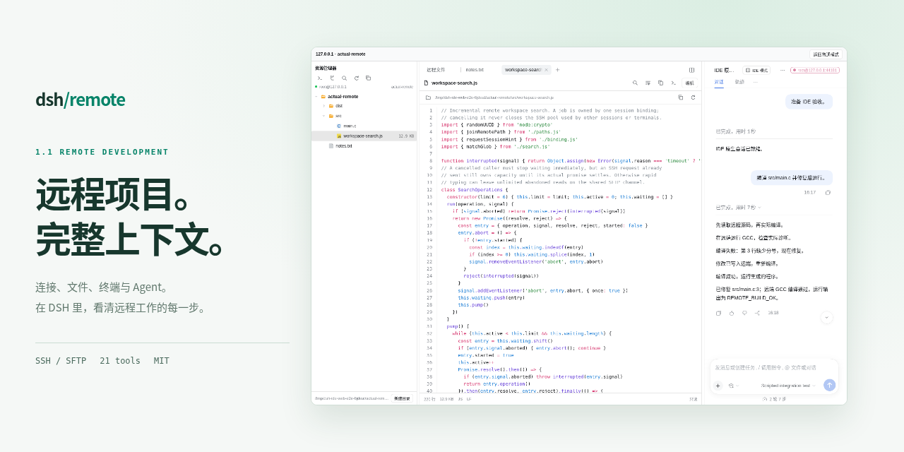
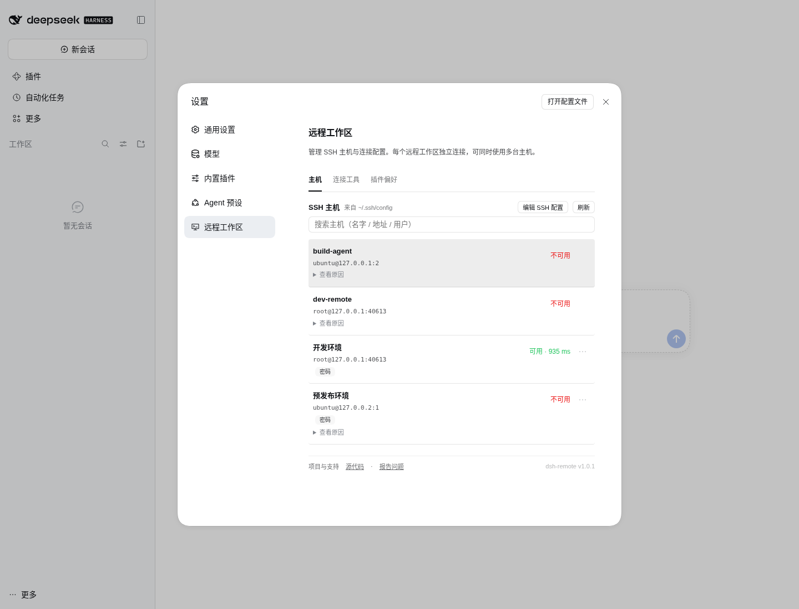
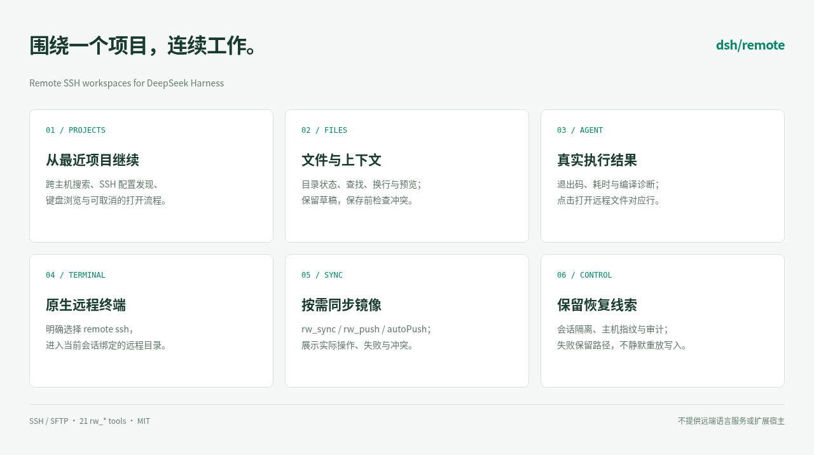

[English](./README.en.md) · **中文**

---

# dsh-remote

[](https://www.npmjs.com/package/dsh-remote)
[](https://www.npmjs.com/package/dsh-remote)
[](https://www.npmjs.com/package/dsh-remote)
[](LICENSE)
[](https://github.com/topics/dsh-plugin)

由 [@flymysql](https://github.com/flymysql) 维护 · [主页](https://flymysql.github.io/dsh-remote/) · [用量统计](https://flymysql.github.io/dsh-remote/stats/) · [博客](https://gitpull.cn) · [讨论区](https://github.com/flymysql/dsh-remote/discussions) · [Issue](https://github.com/flymysql/dsh-remote/issues) · [English](./README.en.md)



**为 [DeepSeek Harness](https://github.com/deepseek-ai/deepseek-harness)（DSH）打造的远程工作助手。**

维护多台 SSH 机器，然后在「选择工作区」时选一个**远程工作区**（或**本地工作区**），Agent 就能在不离开 harness 的情况下直接操作——列文件、读代码、在远程主机上跑构建/命令，并把远程目录镜像成一个真实的本地工作区对象。

DSH 的 Web 界面刻意只监听 `127.0.0.1`（CLI 为安全拒绝 `--host 0.0.0.0`）。本插件反过来：**由你主动连出**到你维护的机器，选一个工作区，然后通过 DSH 原生的工作区 + 文件流来工作——**不改动 `dsh-workspace` 核心**。

反过来也成立：**你可以把远端那台机器的 DSH 网页界面，当成本机浏览器里的一个页面打开**——同样不需要在远端开放任何端口（详见 [在本地打开远程机器上的 DSH 界面](#在本地打开远程机器上的-dsh-界面)）。远端 dsh 需要你先装好（插件不再代装）。

## 界面预览

**设置 → 远程工作区** —— 直接列出 `~/.ssh/config` 里的主机、高级配置（私钥/跳板机/agent）、远程 DSH 界面、端口转发、审计日志、更新：



原生 **「Add workspace / 选择工作区」** 流程 —— 居中弹窗、两个 tab，默认落在「本机」；切到**「远程」**：


- 路径框实时补全；Windows 主机根级显示「此电脑」多盘视图；「浏览…」浮层选中只回填、不直接提交。
- 确定后创建**真实本地镜像**并被 harness 收养，同时通过 SFTP 保持同步；所选工作区持久化到该机器。
- 远程工作区在**创建时**就按 `机器名-目录名` 命名（如 `code-server-xdfs`），不会和本地同名目录混在一起；之后仍可在侧边栏重命名。

---

## 功能



上图是能力总览；下面只列**上图没说清、但用起来需要知道**的部分。

其余要点：

- **21 个模型工具**（便于复制/检索）：`rw_info`、`rw_connect`、`rw_machines`、`rw_pick_workspace`、`rw_list_dir`、`rw_stat`、`rw_read_file`、`rw_write_file`、`rw_edit`、`rw_append`、`rw_mkdir`、`rw_remove`、`rw_move`、`rw_exec`、`rw_search`、`rw_download`、`rw_upload`、`rw_sync`、`rw_push`、`rw_forward`、`rw_disconnect`。
- **会话列表里区分本地/远程**（`0.8.43+`）—— 远程会话的行首有一个**绿点**，悬停显示 `user@host:port` 与远端路径；打开该会话后，标题栏还会常显一个主机标签（本地会话两者都没有）。判定只看会话 cwd 是否落在 `$DSH_HOME/remote-workspaces/…` 镜像里，所以「保存过但没在用」的机器不会给本地会话打标。
- **远程会话的终端开箱即在远端**（`0.8.75+`）—— 侧栏终端的 shell 菜单里有插件贡献的 **remote ssh**：按 cwd 智能路由（远程镜像 → `ssh` 进远端工作目录；本地会话 → 自动回落本地 shell），在没人占位时它还是**默认 shell**。已保存的密码由本机凭据桥自动应答（`0.8.81+`，含操作系统钥匙串里的），不会再每次开终端都问一遍 `password:`。
- **远程文件预览带行号与语法高亮**（`0.8.86+`）—— 代码文件用宿主自家的 Shiki 引擎着色；AI 回答里的 `文件:行号`（或 `#L行号`）链接点开直接落到那一行并闪烁提示。
- **把远端机器的 DSH 界面挂到本机**（`0.8.36+`）—— 不用在远端开任何端口：插件主动 SSH 连过去，在远端**只监听 `127.0.0.1`** 地起一个 `dsh web`，再把端口经隧道搬回本机的一个 loopback 端口。地址带一次性登录令牌，只在本机这次跳转里用一次。
- **审计日志可以在本机直接打开** —— 面板里预览最近条目，另有「打开日志文件」「在文件夹中显示」直接调用本机程序打开那个日志（日志在运行 DSH 的机器上，浏览器打不开它）。
- **远端跨平台** —— 文件访问走 SFTP 协议层（不依赖 POSIX shell），Linux/macOS/Windows 远端都能列/读/写/搜索/同步。
- **Windows 主机** —— 自动探测平台并定位 Git Bash，命令经 `bash -s` 走 stdin 执行，不受引号/反斜杠转义困扰（`config.shell` 可指定或设 `native` 关闭）；`C:\Users\dev` 与 `/c/Users/dev` 两种写法都接受。
- **长任务异步化** —— `rw_sync`/`rw_push` 传 `async: true` 返回 `taskId`，可查询进度/结果/取消。
- **数据跟随 Harness 根目录** —— 机器清单与镜像在 `$DSH_HOME/remote-workspaces`；0.6 之前的数据首次启动自动迁移。
- **`~/.ssh/config` 是连接四字段的唯一来源**（`0.8.50+`，issue #50）—— 保存机器时把 主机/用户/端口/私钥 写入 `~/.ssh/config` 的受管块（`# dsh-remote: managed` 标记，只动自己的块；你手写的同名 Host 块绝不覆盖，会提示冲突）。之后**改这个文件立即生效**：任何 Host 块点名的主机（含字面 IP），连接都按文件解析（裸 `Host *` 是通用默认，不算点名）；机器记录里的副本只做兜底，插件自己的状态（最近工作区/延迟等）仍存注册表。
- **不改动 `dsh-workspace` 官方代码** —— 全部作为普通插件实现。
- **终端界面（dsh-tui）里也有页面** —— `/dsh-remote` 打开服务器管理页（增删改/连接/浏览远端目录），浏览时按 `w` 把当前目录设为工作区；同样不改 dsh-tui 本体。见下文「在 TUI 里使用」。

## 安装

### DSH 版本兼容性

同时支持 `0.1.x` 与 `0.2.x` 两条 DSH 线。DSH 会在导入 bundle **之前**校验所有 `@deepseek-ai/dsh-*` 的 peer 范围，**任一条不匹配就整包丢弃**（没有设置页、没有 `rw_*` 工具）：

```
dsh: skipping profile bundle "dsh-remote": Error: Plugin dsh-remote@… is incompatible …
```

caret 在 `0.x` 上会锁死小版本线（`^0.1.x` 容不下 `0.2.x`，反之亦然），所以自 **0.8.29** 起改为跨线区间 `>=0.1.0-rc.6 <0.3.0`。**低于 0.8.29 请在升级 DSH 前先升级本插件**。

### 官方 Desktop 兼容适配（实验性）

对 [DeepSeek 官方 Desktop](https://github.com/deepseek-ai/deepseek-harness) 的适配（以 `0.1.5-rc.2` Host 协议验证，不修改 Harness 核心）：

- 经 `ctx.connection.fetch` 注册 `/api/dsh-remote/*`，由 Desktop 的 `dsh-app:` 通道承载，不启动 Web Server。
- 经 `sidebarRightTabs` 提供原生「远程文件」入口，不把远端路径传给本地预览器。
- `dsh-better-sidebar` 不再内置；官方 Desktop 用原生右侧栏，不需要它。

已验证 Host 启动、IPC 请求、真实 SSH 的只读连接/列目录/读文件，以及双机会话路由（侧栏 `/ls` `/read` `/write` `/fs` 带 `sessionId` 时按会话选机）。原生文件 tab 的完整 GUI、失败/取消交互、非 macOS 宿主仍属实验性。Desktop 安装器可能需为 `ssh2` / `cpu-features` 可选构建脚本配置策略。

### 已发布的 Web bundle

```bash
dsh plugin add dsh-remote
```

自 **v0.8.18** 起只安装并挂载自身；Web 侧边栏（[dsh-better-sidebar](https://www.npmjs.com/package/dsh-better-sidebar)）改为可选。需要 Web 版远程文件浏览/编辑时再单独装它；不装时 `rw_*` 工具、设置页、同步、审计与转发均照常工作。

> **从 0.7.2–0.8.17 升级：** 内嵌侧边栏会消失，旧 profile 里 `id: dsh-remote-sidebar` 的覆盖可以删除。

（或 `npm install dsh-remote`，再在 `cordis.patch.yml` 加 `- id: dsh-remote / name: dsh-remote`。）

## 快速上手

1. **连接一台机器** —— 设置 → 远程工作区：页面**直接列出 `~/.ssh/config` 里的主机**（像 VSCode Remote-SSH），点「连接」即可（= 采用 + 设为当前 + 实测延迟，结果显示在这一行上）。
   要加一台配置里没有的机器，点「打开配置文件」写一个 Host 段，再点「刷新」。已保存的机器仍可「编辑」（密码、OpenSSH 后端、远端 dsh 命令这些 ssh 配置存不下的项）。
   > **保存 ≠ 激活**：保存只是备用连接；只有「连接」（或 Agent 调 `rw_connect`）才进入会话的 remote context。
2. **选工作区** —— 连上之后会自动弹出目录选择（也可以点机器行的「选目录」）：
   - **远程** → 浏览到远程目录（或输入 `/path`）→ 「设为远程工作区」⇒ 创建并收养本地镜像工作区。
   - **本机** → 系统文件夹选择（或手输路径）→ 本地工作区。宿主没有可用系统对话框时改用插件内置浏览器。
3. **让 Agent 工作** —— 当作普通工作区使用，例如 `rw_read_file` / `rw_write_file` / `rw_edit` / `rw_exec` / `rw_search` / `rw_sync` / `rw_push` / `rw_forward`（完整列表见上文）。

> **Remote context 是 session 级的**：只有当前 session 的工作区是某个远程镜像时，system prompt 才注入「Remote workspace」段落；普通本地 session 不受影响，模型也不会主动调 `rw_*`。

## 在本地打开远程机器上的 DSH 界面

远程机器上那个 `dsh web` 也可以**当成本机的一个页面打开**（issue #46）。方向仍然是「本地主动连出去」：

> **远端不需要开放任何端口**。DSH 刻意拒绝 `--host 0.0.0.0`（它会把远程代码执行能力暴露到网络上），
> 所以正确的做法是由本机 SSH 连过去，在远端**只监听 127.0.0.1** 地起一个 `dsh web`，
> 再把它的端口经 SSH 隧道搬回本机的一个 loopback 端口。

用法：设置 → 远程工作区 → **「远程 DSH 界面」** → 选一台机器 → **连接并打开**。
浏览器会新开一个标签页，显示的就是**那台远端机器**的完整 DSH 界面（聊天、工具树、设置都在）。

- 界面地址形如 `http://127.0.0.1:3088/?token=…`。那个 token 是远端进程启动时打印的一次性凭据，
  只在**本机**的这次跳转里用一次：DSH 会把它换成 30 天有效的签名 cookie 并跳转到干净的 `/`。
  **请不要把这个带 token 的地址外发**。
- 「断开」只关隧道，**不会**杀掉远端进程（它可能是你在别处也在用的实例）；
  要连远端进程一起停，用「断开并停止远端」——它只会结束**本次由插件启动**的那个进程。
- 若远端已经在跑一个界面（比如你自己在终端里起的），可以选机器后把它的
  `http://127.0.0.1:<端口>/?token=…` 粘进输入框，点「连接已有实例」，插件不会再去启第二个。
- 远端 `dsh` 不在 SSH 登录 PATH 时，用 `webAttachCommand` 指向它的绝对路径；
  想让它别污染远端用户自己的会话/设置，用 `webAttachDshHome` 指一个临时目录。
  **按机器设**：设置 → 远程工作区 → 机器卡片 → 展开「高级」→「远端 dsh 命令」，
  填绝对路径即可（例如
  `/home/you/.nvm/versions/node/v22.19.0/bin/node /home/you/.dsh-remote/dsh/node_modules/@deepseek-ai/dsh/lib/bin.js`）；
  留空则用全局的 `webAttachCommand`。
- 隧道跟着 SSH 连接走：连接断了界面会显示「连接已断开」，**不会**影响本机 DSH 进程；
  池自动重连后插件会重新解析远端端口（必要时重启它自己启动的那个远端进程），界面点「重连」即可继续用。
- 远端 node 需要 **≥ 20.12**（dsh 启动要用 `node:util` 的 `parseEnv`，该导出从 20.12 起才有）。
  更旧的 node 上 npm 只会给 EBADENGINE 警告、照样把包装完，直到启动才崩在
  `does not provide an export named 'parseEnv'`，所以装之前先确认版本。

## 在 TUI（dsh-tui）里使用

插件自带 TUI 适配层：装进 `dsh-tui` profile 后，同一份机器清单、SSH 池和远程工作区在
终端界面里也能用，**不修改 dsh-tui 本体**（全部通过它的插件接缝注册）。

```bash
# 已装好 dsh-tui 的机器只需这一条；本地开发可直接给绝对路径
dsh plugin --profile dsh-tui add dsh-remote
# 或：dsh plugin --profile dsh-tui add /path/to/dsh-remote
```

装完重启 dsh-tui 生效。装好之后你会得到：

- `/dsh-remote` 全屏服务器管理页（增删改 / 连接 / 探测 / 浏览远端目录 / 设为工作区 / 清理）；
- `/workspace` 选择器里直接列远程项目（或用 `dshremote://<机器>/<远端路径>` 直达）；
- 底栏状态行显示当前远程机器（仅远程会话，悬停有详情）。

Web profile 不受影响：TUI 层在缺少终端接缝时静默关闭。按键速查、三档清理语义、宿主 API
契约与限制都在 **[docs/tui.md](docs/tui.md)**。

## 可选：CLI 默认机

可在 `cordis.patch.yml` 提供默认机：

```yaml
# 示例：请换成你自己的机器
- id: dsh-remote
  name: dsh-remote
  config:
    host: 203.0.113.10   # 或你的真实主机 / hostname
    port: 22
    username: dev
    privateKeyPath: ~/.ssh/id_rsa
    # 或用密码登录：
    # password: '…'
    workspace: ~/project
```

若 `host` 为空，插件启动时处于断开状态，在 UI 里配置机器即可。

## 常用命令（安装 / 查看 / 启动）

DSH 的 `dsh` 可能不在某些 shell 的 PATH（比如 Windows PowerShell 里在某个仓库目录下），所以同时列出 `dsh` 与 `npx` 两种写法。操作都要用 `--profile <name>` 指定 profile（一般 `web`）：

```bash
# 安装（从 npm 拉到 profile）
dsh plugin --profile web add dsh-remote
# 同一效果：当 `dsh` 不在 PATH 时用 npx
npx --yes @deepseek-ai/dsh plugin --profile web add dsh-remote

# 确认已装
dsh plugin --profile web list
npx --yes @deepseek-ai/dsh plugin --profile web list

# 启动 web 界面（重载 profile，新插件在启动时生效）
dsh --profile web
npx --yes @deepseek-ai/dsh --profile web   # 访问 http://127.0.0.1:3080

# 迭代用本地源码替换 npm 版（便于改 dsh 插件代码后即测）
npx --yes @deepseek-ai/dsh plugin --profile web add D:/path/to/dsh-remote
npx --yes @deepseek-ai/dsh plugin --profile web remove dsh-remote   # 恢复用发行版
```

启动成功后，设置 →「远程工作区」会出现；「Add workspace」流程会带「本机 / 远程」两个 tab（见上方效果图）。

## 开发（沙箱优先，勿改产品）

迭代一律在沙箱里做——手工改产品 profile 会被插件管理器在重装时还原：

```bash
scripts/dev-run.sh --restart   # 启动 / 重启隔离沙箱
scripts/dev-run.sh --stop      # 停止
scripts/dev-run.sh --status    # 是否在运行
```

- 沙箱自带独立 DSH 实例（仓库内 `dev-harness/harness`），UI 在 `http://127.0.0.1:50599`。
- **宿主半**（`lib/index.js`）改动需 `--restart`；**客户端半**（`lib/client.js`）改动刷新页面即可。
- 脚本用**硬链接拷贝**把 `lib/` 放进沙箱而非软链——软链会破坏 `@deepseek-ai/*` 的解析。
- 提交前跑 `node check.mjs`（框架约束闸门）与 `npm test`；`scripts/boot-smoke.sh` 证明插件仍能启动。
- 完整规则见 `scripts/dev-standards.md`。

部署到产品 profile 是单独的受控动作（`./sync.sh`），只在确定要发布时做。

## 配置

| 键 | 类型 | 默认 | 说明 |
| --- | --- | --- | --- |
| `host` | string | `''` | 默认 SSH 主机（空=断开） |
| `port` | int | `22` | 默认 SSH 端口 |
| `username` | string | `''` | 默认 SSH 用户 |
| `password` | string | `''` | 默认 SSH 密码（非空覆盖 key） |
| `privateKeyPath` | string | `''` | 私钥路径（仅在显式提供时使用） |
| `passphrase` | string | `''` | 加密私钥的 passphrase |
| `workspace` | string | `''` | 默认远程工作区路径 |
| `shell` | string | `''` | 远程命令终端策略：`''`=自动检测（Windows 找 Git Bash）、`'git-bash'`=优先 Git Bash、`'native'`=不包装、其他=显式 bash.exe 路径（如 `C:\Program Files\Git\bin\bash.exe`） |
| `commandTimeoutMs` | int | 20000 | 单条远程命令超时 |
| `connectTimeoutMs` | int | 15000 | SSH 连接超时 |
| `maxOutputChars` | int | 200000 | 单条远程命令捕获的 stdout/stderr 上限 |
| `maxFileBytes` | int | 52428800 | 镜像同步时跳过超过该大小的文件（0=不设上限） |
| `hostKeyMode` | string | `accept-new` | 主机指纹策略：`accept-new`（首次信任）、`verify`（拒绝未知主机）、`off`（跳过校验） |
| `useAgent` | bool | `false` | 用 OpenSSH agent（`SSH_AUTH_SOCK`）认证 |
| `keyboardInteractive` | bool | `false` | 允许 keyboard-interactive 认证（OTP/MFA）并复用配置的密码 |
| `backend` | string | `native` | SSH 传输后端（issue #51）。`native`=内置 ssh2（密码/私钥/agent/动态码）；`openssh`=**调用本机 `ssh` 命令**，因此支持 GSSAPI/Kerberos（`kinit` 后免密）以及 `ProxyCommand`、`PKCS11Provider`、`Match` 等 OpenSSH 专有特性。**可按机器单独设置**。代价：每条命令新建一次连接（比 native 慢）；SFTP 仍复用单条长连接。主机名会被**原样**交给 ssh（`~/.ssh/config` 是配置唯一来源），主机密钥也由 ssh 用你自己的 `known_hosts` 校验 |
| `sshBinary` | string | `''` | `openssh` 后端调用的 `ssh` 可执行文件（留空=用 PATH 里的 `ssh`） |
| `proxy` | object | — | 跳板机：`{ host, port?, username?, password?, privateKeyPath? }`；语义是「在跳板机上连目标 host:port」，所以也能用来连跳板机上 docker 容器的 sshd（见「常见问题」里的 issue #56） |
| `autoPush` | bool | `false` | 镜像内文件被编辑后自动推回远端（watcher，带防抖） |
| `auditLog` | bool | `true` | 把执行的命令追加到 `$DSH_HOME/remote-workspaces/audit.log` |
| `encoding` | string | `utf-8` | 远程文件读写的文本编码（如 `gbk`） |
| `fileReference` | bool | `true` | 远程 `@` 补全：远程会话的 `@` 列出**远端**目录树（issue #39）；关闭则只有本地镜像 |
| `fileReferenceMaxResults` | int | `20` | 一次 `@` 查询最多返回多少候选 |
| `fileReferenceMaxEntries` | int | `3000` | 一棵远程工作区索引最多保留多少条目 |
| `fileReferenceExcludedDirectories` | string[] | `[.git, node_modules, dist, build, out, coverage, target, .next, .nuxt, .turbo, .venv, __pycache__, .pytest_cache, .mypy_cache, .gradle]` | 远程 `@` 遍历跳过的目录名 |
| `fileReferenceTimeoutMs` | int | `4000` | 一次远程索引遍历的墙钟预算（超时用已扫到的部分结果，不让光标等） |
| `searchTimeoutMs` | int | `60000` | `rw_search` 的协作式预算（ms）：既作为工具声明的 `timeoutMs` 交给 DSH 的 timeout-policy，也是搜索自身的墙钟上限；到点返回部分结果并标 `TRUNCATED`（issue #44）。 |
| `searchMaxEntries` | int | `50000` | `rw_search` 在返回部分结果前最多扫描多少个文件。 |
| `updateMode` | string | `auto` | 自更新模式：`auto`=加载时及每 6 小时检查并自动应用、`manual`=仅在手动检查时查、`off`=完全不查。**0.8.27 起默认 `auto`**——之所以现在才安全，是因为 0.8.24 补上了宿主半热切换 |
| `updateCheckIntervalMs` | int | 21600000（6h） | `auto` 模式检查 npm 的间隔（下限 60000） |
| `updateAutoReload` | bool | `true` | 更新落地后自动热切换宿主半；`false` 则留到下次启动，设置页会显示 `pendingReload` |
| `webAttachPortStart` | int | `3088` | 「远程 DSH 界面」在本机监听的起始端口（占用则顺延，仅监听 127.0.0.1） |
| `webAttachCommand` | string | `dsh` | 在远端启动 `dsh web` 用的命令；远端 `dsh` 不在 SSH 登录 PATH 时改这里（也可按机器在设置页「高级」里单独设，机器级优先） |
| `webAttachDshHome` | string | `''` | 远端启动时导出的 `DSH_HOME`；留空则复用远端用户自己的 harness home |
| `webAttachWaitSeconds` | int | `45` | 等待远端 `dsh web` 打印启动令牌的秒数 |
| `localTools` | string | `bootstrap` | 本地 session（cwd 不在远程镜像里）暴露哪些 `rw_*` 工具（issue #63）：`bootstrap`=只暴露配置闭环 `rw_machines`/`rw_connect`/`rw_pick_workspace`（其余 19 个在本地 session 必然报 "this session is LOCAL"，暴露只是白占 schema）；`none`=完全不暴露 `rw_*`（远程配置只能走设置页）；`all`=旧的 full 暴露。远程 session（cwd 在镜像里）不受影响，始终全量；非法值按 `bootstrap` 处理 |
| `telemetry` | bool | `true` | 匿名安装心跳（日活统计，每天至多一次；内容为插件专属 HMAC 伪名+版本号，不含机器信息）。`false` 关闭（管理员路径）；0.8.78 曾有的设置页复选框已于 0.8.81 移除——已存在的用户关闭选择仍被尊重 |
| `remoteTerminalDefault` | bool | `true` | 让 shell 菜单里的「remote ssh」启动器成为终端**默认 shell**（宿主未配置、用户未手动选择时）：远程会话开终端即落到远端工作目录，本地会话自动回落本地 shell（issue #55）；`false` 则只保留菜单项 |
| `tui` | bool | `true` | TUI 适配层（dsh-tui）总开关；`false` 时不注册 `/dsh-remote` 页面、工作区 provider 与状态行字段 |
| `tuiProviderListRecent` | bool | `true` | TUI 工作区选择器里是否列出每台机器最近的远程项目 |
| `tuiProviderRecentLimit` | int | `5` | 每台机器列出的最近远程项目数（1–20） |
| `tuiAutoSwitchWorkspace` | bool | `true` | 在浏览目录里按 `w`「设为工作区」后立即把会话切过去 |
| `tuiLang` | string | `''` | TUI 层文案语言：`''`=自动（中文；`DSH_TUI_LANG=en` 时英文），`zh` / `en` 固定 |
| `remoteSandbox` | string | `inherit` | 远程操作套用哪套 sandbox 语义（0.8.54+）：`inherit`=读取本机 `ctx.sandboxPolicy` 已解析的模式（read-only 拒远端写入/命令/转发，workspace-write 把远端写入围在 workspace 根内，danger-full-access 全放行）；`off`=不设围栏（旧行为）；也可显式写某一模式。**这是遏制不是安全边界**，硬边界请在远端一侧做 |
| `credentialFallback` | string | `refuse` | 系统密钥库写密码失败时怎么办（0.8.54+）：`refuse`=不保存该密码（机器照常保存，界面报出失败原因，绝不把明文写进 machines.json）；`plain`=旧的明文回退（会警告）。主动关掉加密（`backend: plain`）不受影响 |

> 权威清单是 `lib/index.js` 里的 `Config` schema，本表与之一致。

## 常见问题 / 排查

快速自救（每条一行；根因故事与设计权衡的完整版搬到了 [docs/troubleshooting.md](docs/troubleshooting.md)）：

- **侧边栏「文件」面板显示的是本地目录** —— 那是镜像工作副本（地基如此）；看远端实时树用
  「远程文件」页签（0.8.82 起进入远程会话自动展开，两个右栏世界都算）。
- **远程终端还要输密码吗？** —— 不用：存过的密码由本机凭据桥自动应答（0.8.81+）；OTP 动态码除外。
- **远程会话的终端开箱即在远端** —— shell 菜单的 remote ssh 是默认终端（0.8.75+，
  `remoteTerminalDefault: false` 可关）。
- **主机指纹变了** —— `/remote forget-key`（或设置页 → 机器 → 重新信任）。
- **连接报「认证失败」** —— 检查用户名/密码/私钥路径；加密私钥要填 Passphrase；OTP 勾选 keyboard-interactive。
- **连不上内网机器** —— 填「跳板机」主机（可把跳板机本身先配成一台机器）；多级链路也支持。
- **想拿容器当工作空间** —— 可以，按容器有没有暴露端口二选一，详见排障手册。

完整排查手册：**[docs/troubleshooting.md](docs/troubleshooting.md)**（含「远程 DSH 界面连不上」专题）。

## 安全提醒

把凭据交给插件等于允许 Agent 以你的用户身份在该主机执行 **shell 命令**——只添加可信机器。密码存在本机文件（或钥匙串），请当作敏感数据。开启 `auditLog` 时每条命令都会记入审计日志。

## License

MIT

## 参与贡献与致谢

欢迎贡献，请先阅读 [CONTRIBUTING.md](./CONTRIBUTING.md)。使用问题、环境配置、「支持 XX 吗」这类讨论请走 [讨论区](https://github.com/flymysql/dsh-remote/discussions)；可复现的缺陷请提 [Issue](https://github.com/flymysql/dsh-remote/issues)。


感谢每一位让这个项目更好的朋友（头像可点进主页；按提交数排序，机器人不计）：

<p align="left">
  <a href="https://github.com/flymysql"></a>
  <a href="https://github.com/baiseraku"></a>
  <a href="https://github.com/glzhangzhi"></a>
  <a href="https://github.com/hjwsm1989"></a>
  <a href="https://github.com/j10ha0"></a>
  <a href="https://github.com/FoolishWiser"></a>
  <a href="https://github.com/kakaa-nju"></a>
  <a href="https://github.com/4FMTWRV"></a>
  <a href="https://github.com/dahaipeng"></a>
  <a href="https://github.com/davidlin2k"></a>
  <a href="https://github.com/FlintyLemming"></a>
  <a href="https://github.com/GDWhisper"></a>
  <a href="https://github.com/YiHui-Liu"></a>
  <a href="https://github.com/Minggle"></a>
  <a href="https://github.com/nekomona"></a>
  <a href="https://github.com/shis23"></a>
</p>

近期的亮点贡献（欢迎随时加入这个名单）：

| 贡献者 | 做了什么 |
| --- | --- |
| [@baiseraku](https://github.com/baiseraku) | 整个 dsh-tui 适配层（[#92](https://github.com/flymysql/dsh-remote/pull/92)）+ 底栏机器名修正（[#98](https://github.com/flymysql/dsh-remote/pull/98)） |
| [@hjwsm1989](https://github.com/hjwsm1989) | 远程 .md 渲染连环两道：memo 守卫（[#102](https://github.com/flymysql/dsh-remote/pull/102)）+ labels 契约（[#107](https://github.com/flymysql/dsh-remote/pull/107)） |
| [@shis23](https://github.com/shis23) | rw_sync 路径映射纠偏 + SFTP 超时韧性（[#105](https://github.com/flymysql/dsh-remote/pull/105)） |
| [@davidlin2k](https://github.com/davidlin2k) | 无凭据机器走用户自有 ssh（[#100](https://github.com/flymysql/dsh-remote/pull/100)） |
| [@GDWhisper](https://github.com/GDWhisper) | 目录补全逐字符重连修复（[#42](https://github.com/flymysql/dsh-remote/pull/42)，issue #41） |
| [@glzhangzhi](https://github.com/glzhangzhi) | 多远端会话的连接池隔离（issue #25 的主体修复） |

早期已合并 PR 的贡献者（考古名单）：


[@dahaipeng](https://github.com/dahaipeng) (#31) ·
[@YiHui-Liu](https://github.com/YiHui-Liu) (#28) ·
[@nekomona](https://github.com/nekomona) (#24) ·
[@zhz1667](https://github.com/zhz1667) (#43) ·
[FoolishWiser](https://github.com/FoolishWiser) (#17) ·
[@jace1cch](https://github.com/jace1cch) (#16) ·
[@Minggle](https://github.com/Minggle) (#10) ·
[4FMTWRV](https://github.com/4FMTWRV) (#6) ·
[glzhangzhi](https://github.com/glzhangzhi)（per-session SSH 连接池修复）

> 名单随版本更新；头像墙之外的每一份 issue 报告、复现步骤、根因线索同样珍贵——
> 本仓库近半修复的起点都是一条写清楚的 issue。

## 变更记录

见 [CHANGELOG.md](./CHANGELOG.md)。