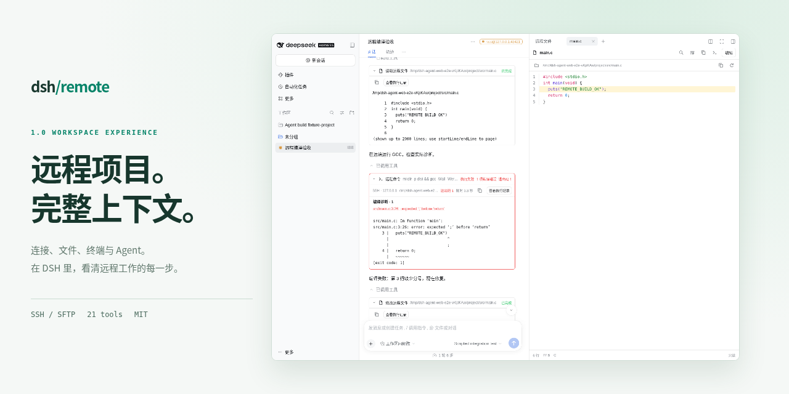
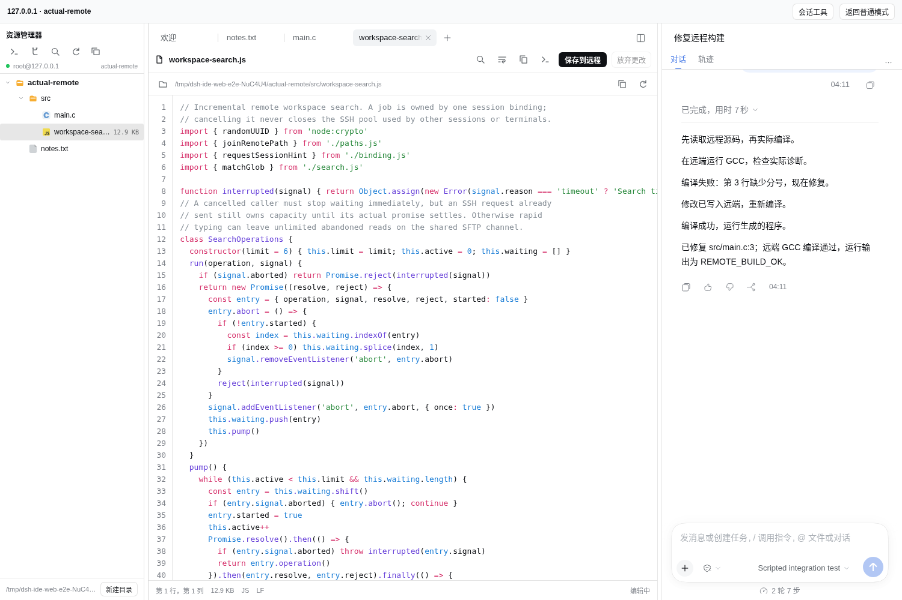
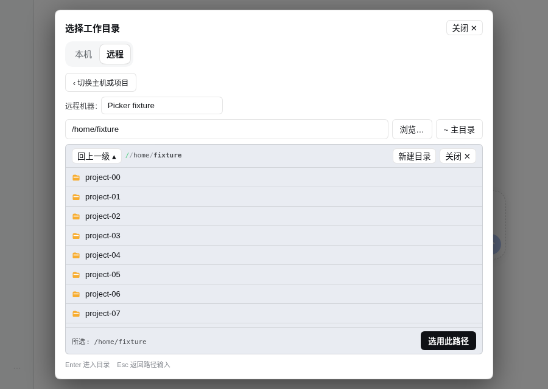
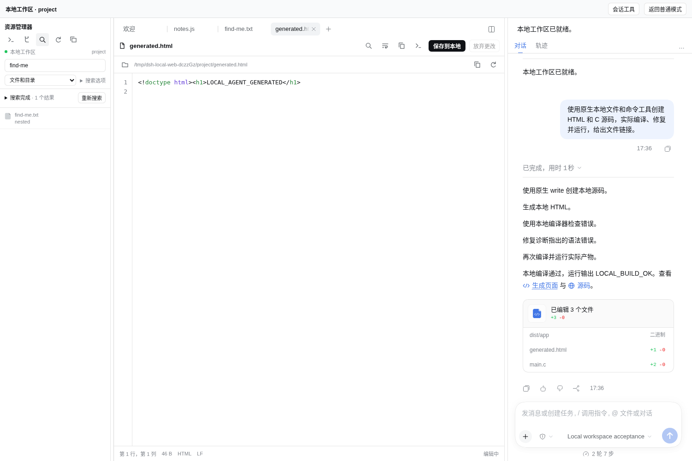
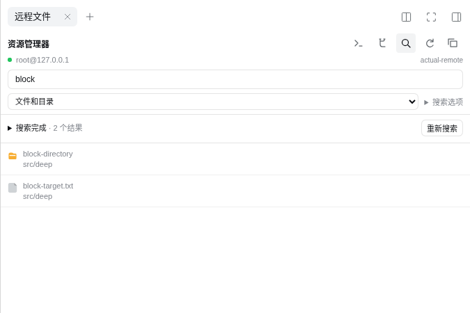
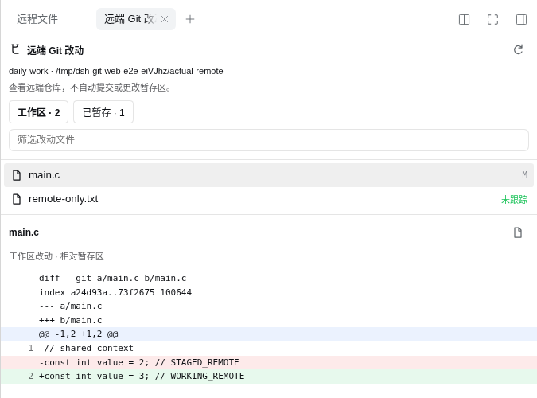
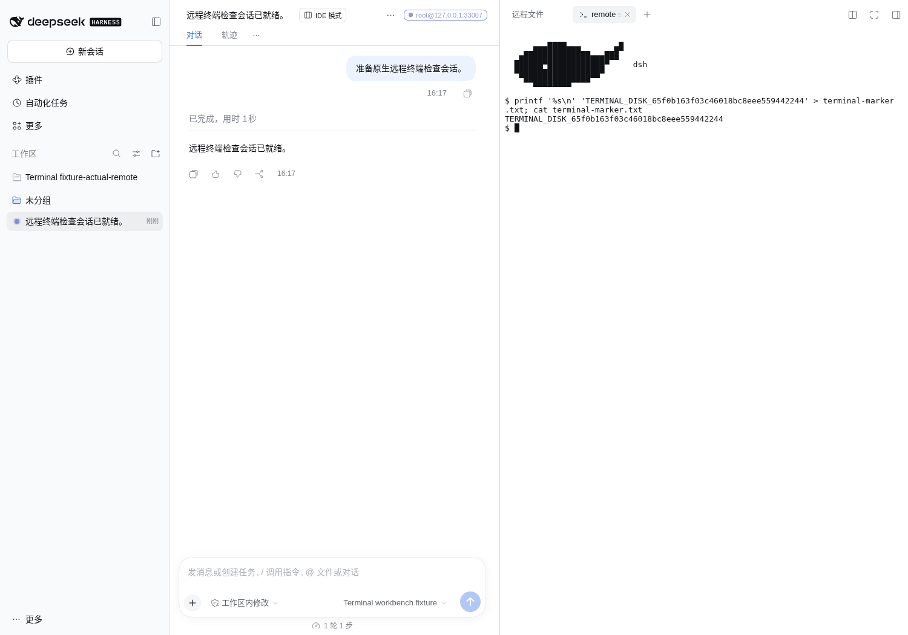
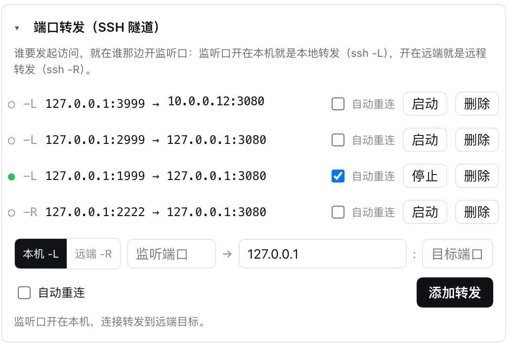
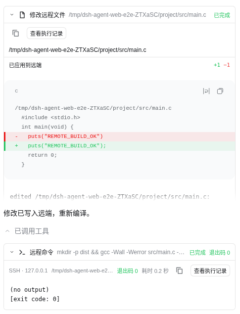

[English](https://github.com/flymysql/dsh-remote/blob/main/README.en.md) · **中文**

# dsh-remote

[](https://www.npmjs.com/package/dsh-remote)
[](https://www.npmjs.com/package/dsh-remote)
[](https://www.npmjs.com/package/dsh-remote)
[](https://github.com/flymysql/dsh-remote/blob/main/LICENSE)
[](https://github.com/topics/dsh-plugin)

由 [@flymysql](https://github.com/flymysql) 维护 · [主页](https://flymysql.github.io/dsh-remote/) · [用量统计](https://flymysql.github.io/dsh-remote/stats/) · [博客](https://gitpull.cn) · [讨论区](https://github.com/flymysql/dsh-remote/discussions) · [Issue](https://github.com/flymysql/dsh-remote/issues) · [English](https://github.com/flymysql/dsh-remote/blob/main/README.en.md)



在 [DeepSeek Harness](https://github.com/deepseek-ai/deepseek-harness) 中，把 SSH 主机变成日常开发工作区：管理多主机项目，浏览和编辑远程文件、递归搜索文件与内容、使用终端、查看 Git 差异、建立本地/反向端口隧道；让 Agent 在所属远程工作区中读写文件、执行命令、构建和测试。多个工作区可独立并行。

可按习惯使用普通布局，或切换 **IDE 三栏布局**，并排查看远程文件、编辑器与原生 Agent 会话；切换时保留任务和未保存编辑。



## 安装

```bash
dsh plugin --profile web add dsh-remote
```

安装或升级后，重启 DSH Web 并刷新页面。自动更新状态在设置 → 远程工作区 → 插件偏好中查看。

[1.5.0 更新说明](https://github.com/flymysql/dsh-remote/blob/main/docs/release/1.5.0.md)：Web 隧道断链自愈、下载到浏览器所在机器、高 RTT 提速 6 倍、堡垒机终端纯登录模式。

## 3 步开始

1. **配置主机**：设置 → 远程工作区，编辑 SSH 配置或保存主机凭据；直接写在 `~/.ssh/config` 里的 Host 会出现在主机列表中，点该行的「…」菜单 →「编辑」即可保存成机器并填写登录密码（保存前后入口都是同一个「…」菜单）。打开设置会自动检查连通性，无需手动“连接”。
2. **创建工作区**：添加工作区 → 远程，选择主机与目录。每个工作区独立绑定主机，设置页不选目录或“当前远程机”。
3. **开始开发**：打开工作区文件或切换 IDE 模式，文件打开即可编辑并显示语法高亮，在远端搜索、运行命令并与 Agent 协作。



## 本地工作区也能用

打开普通本地项目后，点击 **IDE 模式** 或 **工作区文件**，即可使用同一套文件树、高亮编辑、递归搜索、Git 差异与本地终端。无需配置 SSH；Agent 继续使用宿主原生文件和命令工具，多个本地、远程项目可并行工作。



## 日常开发

### 搜索远端文件与内容

文件、目录和内容递归搜索，无需先展开目录或同步镜像。默认界面只显示搜索范围与进度摘要；按需展开搜索选项、扫描详情，支持大小写、忽略项、停止与重试。点击结果进入目录或文件对应行。



### 查看远端 Git 改动

分别查看工作区和已暂存 diff，筛选文件，点击改动行定位源码。面板只读，不提交或修改暂存区。



### 在远端运行终端

终端进入当前会话的远程目录；像素鱼欢迎图后接真实 SSH shell。已保存凭据可自动应答，支持多终端并行。



### 端口转发（SSH 隧道）

谁要发起访问，就在谁那边开监听口：监听口开在本机是本地转发（`ssh -L`），开在远端是远程转发（`ssh -R`）。可同时运行多条；添加转发时可以选择「主机」，每条转发只属于一台机器——给还没连接的主机也能先存下转发，连上后再启动。每条转发都可以点「编辑」调整方向、端口、目标或所属主机，运行中的会先停止、保存后按新配置重新启动。每行能直接勾选「自动重连」——只恢复上次运行中的转发，且按机器隔离，反向转发首次勾选会提示远端监听风险。

从旧版本升级：旧版没有 `lastActive` 的「自动重连」配置会暂停，行上显示「需重新确认」；重新勾选后才会参与自动恢复（反向转发需重新确认远端监听）。



### 与 Agent 一起修改和构建

工具卡展示已应用改动、实际退出码和构建输出，编译诊断可跳转源码。编辑器保存会检测远端冲突、保留 CRLF，并保护保存期间继续输入的内容。



## 兼容与边界

- 主要面向 **DSH Web 0.2.x**；0.2.2 需要 **Node.js ≥24.9**。旧版宿主回退、Desktop/TUI 与 Agent diff 差异见[兼容说明](https://github.com/flymysql/dsh-remote/blob/main/docs/reference.zh.md#dsh-版本兼容性)。
- 文件栏直接访问远端；镜像按需同步。草稿在当前页面内存，崩溃或强制退出仍可能丢失。
- 不提供远端语言服务、扩展宿主或调试器。Agent 使用配置的 SSH 身份执行命令，请只配置可信主机。

## 文档与社区

[完整工具与配置参考](https://github.com/flymysql/dsh-remote/blob/main/docs/reference.zh.md) · [排障](https://github.com/flymysql/dsh-remote/blob/main/docs/troubleshooting.md) · [自更新修复](https://github.com/flymysql/dsh-remote/blob/main/docs/self-heal.md) · [升级指南](https://github.com/flymysql/dsh-remote/blob/main/docs/migration-1.0.md) · [更新记录](https://github.com/flymysql/dsh-remote/blob/main/CHANGELOG.md)

[主页](https://flymysql.github.io/dsh-remote/) · [讨论区](https://github.com/flymysql/dsh-remote/discussions) · [反馈问题](https://github.com/flymysql/dsh-remote/issues) · [贡献指南](https://github.com/flymysql/dsh-remote/blob/main/CONTRIBUTING.md) · [贡献者与致谢](#贡献者与致谢)

由 [@flymysql](https://github.com/flymysql) 与社区共同维护 · [MIT](https://github.com/flymysql/dsh-remote/blob/main/LICENSE)

### 贡献者与致谢

感谢每一位让这个项目更好的朋友（头像可点进主页；按提交数排序，机器人不计）：

<p align="left">
  <a href="https://github.com/flymysql"></a>
  <a href="https://github.com/baiseraku"></a>
  <a href="https://github.com/glzhangzhi"></a>
  <a href="https://github.com/hjwsm1989"></a>
  <a href="https://github.com/j10ha0"></a>
  <a href="https://github.com/FoolishWiser"></a>
  <a href="https://github.com/kakaa-nju"></a>
  <a href="https://github.com/4FMTWRV"></a>
  <a href="https://github.com/dahaipeng"></a>
  <a href="https://github.com/davidlin2k"></a>
  <a href="https://github.com/FlintyLemming"></a>
  <a href="https://github.com/GDWhisper"></a>
  <a href="https://github.com/YiHui-Liu"></a>
  <a href="https://github.com/Minggle"></a>
  <a href="https://github.com/nekomona"></a>
  <a href="https://github.com/shis23"></a>
</p>

<details>
<summary>贡献记录与早期贡献者</summary>

近期的亮点贡献（欢迎随时加入这个名单）：

| 贡献者 | 做了什么 |
| --- | --- |
| [@baiseraku](https://github.com/baiseraku) | 整个 dsh-tui 适配层（[#92](https://github.com/flymysql/dsh-remote/pull/92)）+ 底栏机器名修正（[#98](https://github.com/flymysql/dsh-remote/pull/98)） |
| [@hjwsm1989](https://github.com/hjwsm1989) | 远程 .md 渲染连环两道：memo 守卫（[#102](https://github.com/flymysql/dsh-remote/pull/102)）+ labels 契约（[#107](https://github.com/flymysql/dsh-remote/pull/107)） |
| [@shis23](https://github.com/shis23) | rw_sync 路径映射纠偏 + SFTP 超时韧性（[#105](https://github.com/flymysql/dsh-remote/pull/105)） |
| [@davidlin2k](https://github.com/davidlin2k) | 无凭据机器走用户自有 ssh（[#100](https://github.com/flymysql/dsh-remote/pull/100)） |
| [@GDWhisper](https://github.com/GDWhisper) | 目录补全逐字符重连修复（[#42](https://github.com/flymysql/dsh-remote/pull/42)，issue #41） |
| [@glzhangzhi](https://github.com/glzhangzhi) | 多远端会话的连接池隔离（issue #25 的主体修复） |

早期已合并 PR 的贡献者（考古名单）：


[@dahaipeng](https://github.com/dahaipeng) (#31) ·
[@YiHui-Liu](https://github.com/YiHui-Liu) (#28) ·
[@nekomona](https://github.com/nekomona) (#24) ·
[@zhz1667](https://github.com/zhz1667) (#43) ·
[FoolishWiser](https://github.com/FoolishWiser) (#17) ·
[@jace1cch](https://github.com/jace1cch) (#16) ·
[@Minggle](https://github.com/Minggle) (#10) ·
[4FMTWRV](https://github.com/4FMTWRV) (#6) ·
[glzhangzhi](https://github.com/glzhangzhi)（per-session SSH 连接池修复）

> 名单随版本更新；头像墙之外的每一份 issue 报告、复现步骤、根因线索同样珍贵——
> 本仓库近半修复的起点都是一条写清楚的 issue。

</details>
