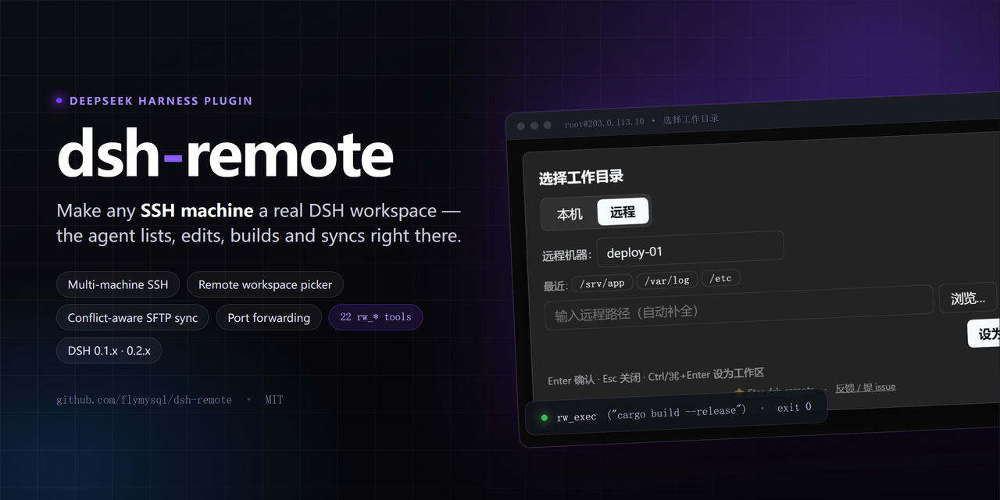
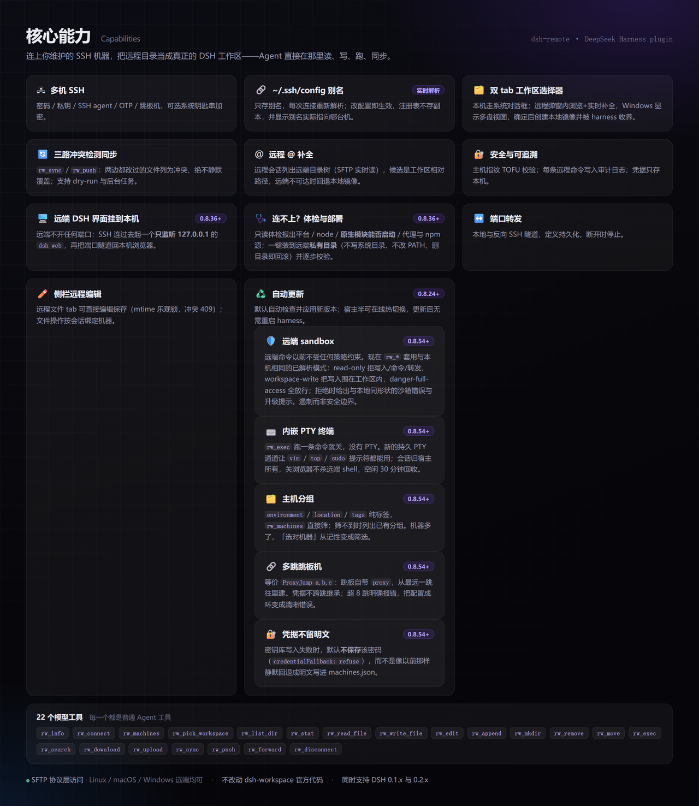

[English](./README.en.md) · **中文**

---

# dsh-remote

[](https://www.npmjs.com/package/dsh-remote)
[](https://www.npmjs.com/package/dsh-remote)
[](https://www.npmjs.com/package/dsh-remote)
[](LICENSE)
[](https://github.com/topics/dsh-plugin)

由 [@flymysql](https://github.com/flymysql) 维护 · [主页](https://flymysql.github.io/dsh-remote/) · [用量统计](https://flymysql.github.io/dsh-remote/stats/) · [博客](https://gitpull.cn) · [讨论区](https://github.com/flymysql/dsh-remote/discussions) · [Issue](https://github.com/flymysql/dsh-remote/issues) · [English](./README.en.md)



**为 [DeepSeek Harness](https://github.com/deepseek-ai/deepseek-harness)（DSH）打造的远程工作助手。**

维护多台 SSH 机器，然后在「选择工作区」时选一个**远程工作区**（或**本地工作区**），Agent 就能在不离开 harness 的情况下直接操作——列文件、读代码、在远程主机上跑构建/命令，并把远程目录镜像成一个真实的本地工作区对象。

DSH 的 Web 界面刻意只监听 `127.0.0.1`（CLI 为安全拒绝 `--host 0.0.0.0`）。本插件反过来：**由你主动连出**到你维护的机器，选一个工作区，然后通过 DSH 原生的工作区 + 文件流来工作——**不改动 `dsh-workspace` 核心**。

反过来也成立：**你可以把远端那台机器的 DSH 网页界面，当成本机浏览器里的一个页面打开**——同样不需要在远端开放任何端口（详见 [在本地打开远程机器上的 DSH 界面](#在本地打开远程机器上的-dsh-界面)）。连不上时还有**一键体检与部署**，它会替你把远端环境修好并验证。

## 界面预览

**设置 → 远程工作区** —— 多机列表、高级配置（私钥/跳板机/agent）、连接体检、远程 DSH 界面、端口转发、审计日志、更新：


原生 **「Add workspace / 选择工作区」** 流程 —— 居中弹窗、两个 tab，默认落在「本机」；切到**「远程」**：


- 路径框实时补全；Windows 主机根级显示「此电脑」多盘视图；「浏览…」浮层选中只回填、不直接提交。
- 确定后创建**真实本地镜像**并被 harness 收养，同时通过 SFTP 保持同步；所选工作区持久化到该机器。

---

## 功能



上图是能力总览；下面只列**上图没说清、但用起来需要知道**的部分。

其余要点：

- **22 个模型工具**（便于复制/检索）：`rw_info`、`rw_connect`、`rw_machines`、`rw_pick_workspace`、`rw_list_dir`、`rw_stat`、`rw_read_file`、`rw_write_file`、`rw_edit`、`rw_append`、`rw_mkdir`、`rw_remove`、`rw_move`、`rw_exec`、`rw_search`、`rw_download`、`rw_upload`、`rw_sync`、`rw_push`、`rw_forward`、`rw_disconnect`、`rw_deploy_probe`。
- **会话列表里区分本地/远程**（`0.8.43+`）—— 远程会话的行首有一个**绿点**，悬停显示 `user@host:port` 与远端路径；打开该会话后，标题栏还会常显一个主机标签（本地会话两者都没有）。判定只看会话 cwd 是否落在 `$DSH_HOME/remote-workspaces/…` 镜像里，所以「保存过但没在用」的机器不会给本地会话打标。
- **把远端机器的 DSH 界面挂到本机**（`0.8.36+`）—— 不用在远端开任何端口：插件主动 SSH 连过去，在远端**只监听 `127.0.0.1`** 地起一个 `dsh web`，再把端口经隧道搬回本机的一个 loopback 端口。地址带一次性登录令牌，只在本机这次跳转里用一次。
- **连不上时一键体检与部署**（`0.8.36+`）—— **连不上大多不是插件的问题，而是远端 dsh 的版本或环境不对**。体检（只读）会报出平台/node/npm/dsh 版本、**原生模块能否启动**、代理与 npm 源，并给出修复建议；「部署并验证」把它装到远端**私有目录**（不写系统目录、不改 PATH、不覆盖你在用的版本，删目录即回滚）并逐步校验。按钮**不再需要先体检**——直接点即可（`0.8.40+`），部署过程自己会重新体检。失败还能交给内置的 `dsh-remote-deploy` 技能排查。
- **远端跨平台** —— 文件访问走 SFTP 协议层（不依赖 POSIX shell），Linux/macOS/Windows 远端都能列/读/写/搜索/同步。
- **Windows 主机** —— 自动探测平台并定位 Git Bash，命令经 `bash -s` 走 stdin 执行，不受引号/反斜杠转义困扰（`config.shell` 可指定或设 `native` 关闭）；`C:\Users\dev` 与 `/c/Users/dev` 两种写法都接受。
- **长任务异步化** —— `rw_sync`/`rw_push` 传 `async: true` 返回 `taskId`，可查询进度/结果/取消。
- **数据跟随 Harness 根目录** —— 机器清单与镜像在 `$DSH_HOME/remote-workspaces`；0.6 之前的数据首次启动自动迁移。
- **`~/.ssh/config` 是连接四字段的唯一来源**（`0.8.50+`，issue #50）—— 保存机器时把 主机/用户/端口/私钥 写入 `~/.ssh/config` 的受管块（`# dsh-remote: managed` 标记，只动自己的块；你手写的同名 Host 块绝不覆盖，会提示冲突）。之后**改这个文件立即生效**：任何 Host 块点名的主机（含字面 IP），连接都按文件解析（裸 `Host *` 是通用默认，不算点名）；机器记录里的副本只做兜底，插件自己的状态（最近工作区/延迟等）仍存注册表。
- **不改动 `dsh-workspace` 官方代码** —— 全部作为普通插件实现。

## 安装

### DSH 版本兼容性

同时支持 `0.1.x` 与 `0.2.x` 两条 DSH 线。DSH 会在导入 bundle **之前**校验所有 `@deepseek-ai/dsh-*` 的 peer 范围，**任一条不匹配就整包丢弃**（没有设置页、没有 `rw_*` 工具）：

```
dsh: skipping profile bundle "dsh-remote": Error: Plugin dsh-remote@… is incompatible …
```

caret 在 `0.x` 上会锁死小版本线（`^0.1.x` 容不下 `0.2.x`，反之亦然），所以自 **0.8.29** 起改为跨线区间 `>=0.1.0-rc.6 <0.3.0`。**低于 0.8.29 请在升级 DSH 前先升级本插件**。

### 官方 Desktop 兼容适配（实验性）

对 [DeepSeek 官方 Desktop](https://github.com/deepseek-ai/deepseek-harness) 的适配（以 `0.1.5-rc.2` Host 协议验证，不修改 Harness 核心）：

- 经 `ctx.connection.fetch` 注册 `/api/dsh-remote/*`，由 Desktop 的 `dsh-app:` 通道承载，不启动 Web Server。
- 经 `sidebarRightTabs` 提供原生「远程文件」入口，不把远端路径传给本地预览器。
- `dsh-better-sidebar` 不再内置；官方 Desktop 用原生右侧栏，不需要它。

已验证 Host 启动、IPC 请求、真实 SSH 的只读连接/列目录/读文件，以及双机会话路由（侧栏 `/ls` `/read` `/write` `/fs` 带 `sessionId` 时按会话选机）。原生文件 tab 的完整 GUI、失败/取消交互、非 macOS 宿主仍属实验性。Desktop 安装器可能需为 `ssh2` / `cpu-features` 可选构建脚本配置策略。

### 已发布的 Web bundle

```bash
dsh plugin add dsh-remote
```

自 **v0.8.18** 起只安装并挂载自身；Web 侧边栏（[dsh-better-sidebar](https://www.npmjs.com/package/dsh-better-sidebar)）改为可选。需要 Web 版远程文件浏览/编辑时再单独装它；不装时 `rw_*` 工具、设置页、同步、审计与转发均照常工作。

> **从 0.7.2–0.8.17 升级：** 内嵌侧边栏会消失，旧 profile 里 `id: dsh-remote-sidebar` 的覆盖可以删除。

（或 `npm install dsh-remote`，再在 `cordis.patch.yml` 加 `- id: dsh-remote / name: dsh-remote`。）

## 快速上手

1. **加一台机器** —— 设置 → 远程工作区 → 填 host/port/user + 密码或 key → 设为当前。
   > **保存 ≠ 激活**：保存只是备用连接；只有「设为当前」（或 Agent 调 `rw_connect`）才进入会话的 remote context。
2. **选工作区** —— 点侧边栏/会话的 **Add workspace**：
   - **本机** → 系统文件夹选择（或手输路径）→ 本地工作区。宿主没有可用系统对话框时改用插件内置浏览器。
   - **远程** → 选机器 → 浏览到远程目录（或输入 `/path`）→ 「设为远程工作区」⇒ 创建并收养本地镜像工作区。
3. **让 Agent 工作** —— 当作普通工作区使用，例如 `rw_read_file` / `rw_write_file` / `rw_edit` / `rw_exec` / `rw_search` / `rw_sync` / `rw_push` / `rw_forward`（完整列表见上文）。

> **Remote context 是 session 级的**：只有当前 session 的工作区是某个远程镜像时，system prompt 才注入「Remote workspace」段落；普通本地 session 不受影响，模型也不会主动调 `rw_*`。

## 在本地打开远程机器上的 DSH 界面

远程机器上那个 `dsh web` 也可以**当成本机的一个页面打开**（issue #46）。方向仍然是「本地主动连出去」：

> **远端不需要开放任何端口**。DSH 刻意拒绝 `--host 0.0.0.0`（它会把远程代码执行能力暴露到网络上），
> 所以正确的做法是由本机 SSH 连过去，在远端**只监听 127.0.0.1** 地起一个 `dsh web`，
> 再把它的端口经 SSH 隧道搬回本机的一个 loopback 端口。

用法：设置 → 远程工作区 → **「远程 DSH 界面」** → 选一台机器 → **连接并打开**。
浏览器会新开一个标签页，显示的就是**那台远端机器**的完整 DSH 界面（聊天、工具树、设置都在）。

- 界面地址形如 `http://127.0.0.1:3088/?token=…`。那个 token 是远端进程启动时打印的一次性凭据，
  只在**本机**的这次跳转里用一次：DSH 会把它换成 30 天有效的签名 cookie 并跳转到干净的 `/`。
  **请不要把这个带 token 的地址外发**。
- 「断开」只关隧道，**不会**杀掉远端进程（它可能是你在别处也在用的实例）；
  要连远端进程一起停，用「断开并停止远端」——它只会结束**本次由插件启动**的那个进程。
- 若远端已经在跑一个界面（比如你自己在终端里起的），可以选机器后把它的
  `http://127.0.0.1:<端口>/?token=…` 粘进输入框，点「连接已有实例」，插件不会再去启第二个。
- 远端 `dsh` 不在 SSH 登录 PATH 时，用 `webAttachCommand` 指向它的绝对路径；
  想让它别污染远端用户自己的会话/设置，用 `webAttachDshHome` 指一个临时目录。
  **按机器设**：设置 → 远程工作区 → 机器卡片 → 展开「高级」→「远端 dsh 命令」，
  填绝对路径即可（例如
  `/home/you/.nvm/versions/node/v22.19.0/bin/node /home/you/.dsh-remote/dsh/node_modules/@deepseek-ai/dsh/lib/bin.js`）；
  留空则用全局的 `webAttachCommand`。「部署并验证」成功后也会自动写进这个字段。
- 隧道跟着 SSH 连接走：连接断了界面会显示「连接已断开」，**不会**影响本机 DSH 进程；
  池自动重连后插件会重新解析远端端口（必要时重启它自己启动的那个远端进程），界面点「重连」即可继续用。
- 远端 node 需要 **≥ 20.12**（dsh 启动要用 `node:util` 的 `parseEnv`，该导出从 20.12 起才有）。
  node 太旧时体检会直接报 blocker：npm 只会给 EBADENGINE 警告、照样把包装完，
  直到启动才崩在 `does not provide an export named 'parseEnv'`，所以必须在装之前拦住。

### 连不上？先体检，再一键部署

**连不上大多不是插件的问题，而是远端 dsh 的版本或环境不对。** 最典型的一种：dsh 0.1.0-rc.6
依赖 `node-pty@1.1.0`，而**那个版本发布的包里没有 `linux-x64` 预编译产物** ⇒ `dsh web`
在 Linux 上根本起不来。这种情况以前只能看到「没拿到启动令牌」，无从判断。

设置 → 远程工作区 → **「远端 dsh 体检与部署」**：

1. **体检（只读）** —— 探测远端平台/node/npm/dsh 版本/**原生模块能否启动**/是否认识
   `--no-open`/代理与 npm 源，给出结论与修复建议。**不写任何东西**，可以随便点。
2. **部署并验证** —— 只在上一步判定「需要且可以自动装」时才出现。它会装到远端
   **私有目录**（默认 `~/.dsh-remote/dsh`）：**不写系统目录、不改 PATH、不覆盖你在用的版本**，
   删掉那个目录即完全回滚。装完逐步校验（二进制 / 原生模块 / `web` 子命令），
   成功后**按机器记住**这条 dsh 路径，之后连接就用它。
3. **让 AI 排查** —— 只在失败后出现。它会创建一个会话，让内置的 `dsh-remote-deploy`
   技能去处理确定性流程覆盖不到的长尾（没有 npm、要 sudo、代理、内网镜像源、Windows 远端等）。
   **只有你点它才会创建**，因为这会消耗模型额度。

相关配置：`webInstallPrefix`（装哪，默认 `$HOME/.dsh-remote/dsh`）、
`webInstallVersion`（装哪个版本，默认 `0.1.5-rc.2`——第一个在 Linux 上能起 web 的版本）、
`webInstallRegistry`（npm 源；**留空则沿用远端自己的配置**，不会覆盖你的内网镜像）。

## 可选：CLI 默认机

可在 `cordis.patch.yml` 提供默认机：

```yaml
# 示例：请换成你自己的机器
- id: dsh-remote
  name: dsh-remote
  config:
    host: 203.0.113.10   # 或你的真实主机 / hostname
    port: 22
    username: dev
    privateKeyPath: ~/.ssh/id_rsa
    # 或用密码登录：
    # password: '…'
    workspace: ~/project
```

若 `host` 为空，插件启动时处于断开状态，在 UI 里配置机器即可。

## 常用命令（安装 / 查看 / 启动）

DSH 的 `dsh` 可能不在某些 shell 的 PATH（比如 Windows PowerShell 里在某个仓库目录下），所以同时列出 `dsh` 与 `npx` 两种写法。操作都要用 `--profile <name>` 指定 profile（一般 `web`）：

```bash
# 安装（从 npm 拉到 profile）
dsh plugin --profile web add dsh-remote
# 同一效果：当 `dsh` 不在 PATH 时用 npx
npx --yes @deepseek-ai/dsh plugin --profile web add dsh-remote

# 确认已装
dsh plugin --profile web list
npx --yes @deepseek-ai/dsh plugin --profile web list

# 启动 web 界面（重载 profile，新插件在启动时生效）
dsh --profile web
npx --yes @deepseek-ai/dsh --profile web   # 访问 http://127.0.0.1:3080

# 迭代用本地源码替换 npm 版（便于改 dsh 插件代码后即测）
npx --yes @deepseek-ai/dsh plugin --profile web add D:/path/to/dsh-remote
npx --yes @deepseek-ai/dsh plugin --profile web remove dsh-remote   # 恢复用发行版
```

启动成功后，设置 →「远程工作区」会出现；「Add workspace」流程会带「本机 / 远程」两个 tab（见上方效果图）。

## 开发（沙箱优先，勿改产品）

迭代一律在沙箱里做——手工改产品 profile 会被插件管理器在重装时还原：

```bash
scripts/dev-run.sh --restart   # 启动 / 重启隔离沙箱
scripts/dev-run.sh --stop      # 停止
scripts/dev-run.sh --status    # 是否在运行
```

- 沙箱自带独立 DSH 实例（仓库内 `dev-harness/harness`），UI 在 `http://127.0.0.1:50599`。
- **宿主半**（`lib/index.js`）改动需 `--restart`；**客户端半**（`lib/client.js`）改动刷新页面即可。
- 脚本用**硬链接拷贝**把 `lib/` 放进沙箱而非软链——软链会破坏 `@deepseek-ai/*` 的解析。
- 提交前跑 `node check.mjs`（框架约束闸门）与 `npm test`；`scripts/boot-smoke.sh` 证明插件仍能启动。
- 完整规则见 `scripts/dev-standards.md`。

部署到产品 profile 是单独的受控动作（`./sync.sh`），只在确定要发布时做。

## 配置

| 键 | 类型 | 默认 | 说明 |
| --- | --- | --- | --- |
| `host` | string | `''` | 默认 SSH 主机（空=断开） |
| `port` | int | `22` | 默认 SSH 端口 |
| `username` | string | `''` | 默认 SSH 用户 |
| `password` | string | `''` | 默认 SSH 密码（非空覆盖 key） |
| `privateKeyPath` | string | `''` | 私钥路径（仅在显式提供时使用） |
| `passphrase` | string | `''` | 加密私钥的 passphrase |
| `workspace` | string | `''` | 默认远程工作区路径 |
| `shell` | string | `''` | 远程命令终端策略：`''`=自动检测（Windows 找 Git Bash）、`'git-bash'`=优先 Git Bash、`'native'`=不包装、其他=显式 bash.exe 路径（如 `C:\Program Files\Git\bin\bash.exe`） |
| `commandTimeoutMs` | int | 20000 | 单条远程命令超时 |
| `connectTimeoutMs` | int | 15000 | SSH 连接超时 |
| `maxOutputChars` | int | 200000 | 单条远程命令捕获的 stdout/stderr 上限 |
| `maxFileBytes` | int | 52428800 | 镜像同步时跳过超过该大小的文件（0=不设上限） |
| `hostKeyMode` | string | `accept-new` | 主机指纹策略：`accept-new`（首次信任）、`verify`（拒绝未知主机）、`off`（跳过校验） |
| `useAgent` | bool | `false` | 用 OpenSSH agent（`SSH_AUTH_SOCK`）认证 |
| `keyboardInteractive` | bool | `false` | 允许 keyboard-interactive 认证（OTP/MFA）并复用配置的密码 |
| `backend` | string | `native` | SSH 传输后端（issue #51）。`native`=内置 ssh2（密码/私钥/agent/动态码）；`openssh`=**调用本机 `ssh` 命令**，因此支持 GSSAPI/Kerberos（`kinit` 后免密）以及 `ProxyCommand`、`PKCS11Provider`、`Match` 等 OpenSSH 专有特性。**可按机器单独设置**。代价：每条命令新建一次连接（比 native 慢）；SFTP 仍复用单条长连接。主机名会被**原样**交给 ssh（`~/.ssh/config` 是配置唯一来源），主机密钥也由 ssh 用你自己的 `known_hosts` 校验 |
| `sshBinary` | string | `''` | `openssh` 后端调用的 `ssh` 可执行文件（留空=用 PATH 里的 `ssh`） |
| `proxy` | object | — | 跳板机：`{ host, port?, username?, password?, privateKeyPath? }`；语义是「在跳板机上连目标 host:port」，所以也能用来连跳板机上 docker 容器的 sshd（见「常见问题」里的 issue #56） |
| `autoPush` | bool | `false` | 镜像内文件被编辑后自动推回远端（watcher，带防抖） |
| `auditLog` | bool | `true` | 把执行的命令追加到 `$DSH_HOME/remote-workspaces/audit.log` |
| `encoding` | string | `utf-8` | 远程文件读写的文本编码（如 `gbk`） |
| `fileReference` | bool | `true` | 远程 `@` 补全：远程会话的 `@` 列出**远端**目录树（issue #39）；关闭则只有本地镜像 |
| `fileReferenceMaxResults` | int | `20` | 一次 `@` 查询最多返回多少候选 |
| `fileReferenceMaxEntries` | int | `3000` | 一棵远程工作区索引最多保留多少条目 |
| `fileReferenceExcludedDirectories` | string[] | `[.git, node_modules, dist, build, out, coverage, target, .next, .nuxt, .turbo, .venv, __pycache__, .pytest_cache, .mypy_cache, .gradle]` | 远程 `@` 遍历跳过的目录名 |
| `fileReferenceTimeoutMs` | int | `4000` | 一次远程索引遍历的墙钟预算（超时用已扫到的部分结果，不让光标等） |
| `searchTimeoutMs` | int | `60000` | `rw_search` 的协作式预算（ms）：既作为工具声明的 `timeoutMs` 交给 DSH 的 timeout-policy，也是搜索自身的墙钟上限；到点返回部分结果并标 `TRUNCATED`（issue #44）。 |
| `searchMaxEntries` | int | `50000` | `rw_search` 在返回部分结果前最多扫描多少个文件。 |
| `updateMode` | string | `auto` | 自更新模式：`auto`=加载时及每 6 小时检查并自动应用、`manual`=仅在手动检查时查、`off`=完全不查。**0.8.27 起默认 `auto`**——之所以现在才安全，是因为 0.8.24 补上了宿主半热切换 |
| `updateCheckIntervalMs` | int | 21600000（6h） | `auto` 模式检查 npm 的间隔（下限 60000） |
| `updateAutoReload` | bool | `true` | 更新落地后自动热切换宿主半；`false` 则留到下次启动，设置页会显示 `pendingReload` |
| `webAttachPortStart` | int | `3088` | 「远程 DSH 界面」在本机监听的起始端口（占用则顺延，仅监听 127.0.0.1） |
| `webAttachCommand` | string | `dsh` | 在远端启动 `dsh web` 用的命令；远端 `dsh` 不在 SSH 登录 PATH 时改这里（也可按机器在设置页「高级」里单独设，机器级优先） |
| `webAttachDshHome` | string | `''` | 远端启动时导出的 `DSH_HOME`；留空则复用远端用户自己的 harness home |
| `webAttachWaitSeconds` | int | `45` | 等待远端 `dsh web` 打印启动令牌的秒数 |
| `webInstallPrefix` | string | `''` | 自动部署装到远端的哪个目录；留空用 `$HOME/.dsh-remote/dsh`（不写系统目录、不改 PATH） |
| `webInstallVersion` | string | `0.1.5-rc.2` | 自动部署安装的 dsh 版本；默认值是第一个在 Linux 上能启动 web 的版本 |
| `webInstallRegistry` | string | `''` | 安装用的 npm 源；**留空沿用远端自己的配置**，不会覆盖内网镜像 |
| `localTools` | string | `bootstrap` | 本地 session（cwd 不在远程镜像里）暴露哪些 `rw_*` 工具（issue #63）：`bootstrap`=只暴露配置闭环 `rw_machines`/`rw_connect`/`rw_pick_workspace`（其余 19 个在本地 session 必然报 "this session is LOCAL"，暴露只是白占 schema）；`none`=完全不暴露 `rw_*`（远程配置只能走设置页）；`all`=旧的 full 暴露。远程 session（cwd 在镜像里）不受影响，始终全量；非法值按 `bootstrap` 处理 |
| `remoteSandbox` | string | `inherit` | 远程操作套用哪套 sandbox 语义（0.8.54+）：`inherit`=读取本机 `ctx.sandboxPolicy` 已解析的模式（read-only 拒远端写入/命令/转发，workspace-write 把远端写入围在 workspace 根内，danger-full-access 全放行）；`off`=不设围栏（旧行为）；也可显式写某一模式。**这是遏制不是安全边界**，硬边界请在远端一侧做 |
| `credentialFallback` | string | `refuse` | 系统密钥库写密码失败时怎么办（0.8.54+）：`refuse`=不保存该密码（机器照常保存，界面报出失败原因，绝不把明文写进 machines.json）；`plain`=旧的明文回退（会警告）。主动关掉加密（`backend: plain`）不受影响 |

> 权威清单是 `lib/index.js` 里的 `Config` schema，本表与之一致。

## 常见问题 / 排查

**`@` 能列出远程文件，但内置读文件工具打不开** —— harness 自带工具看到的是**本地镜像**，要等 `rw_sync` 下载后才有内容。读远程文件请用 `rw_read_file` 或侧栏远程文件 tab。

**远程会话里的文件链接打不开**（issue #55）—— 已修。链接被点开时 harness 会把它变成
`dsh-resource://file/session/<会话>/<路径>`，然后交给内置的文本预览去读；而那个预览读的是**本机**
文件系统，远程会话的 cwd 是**本地镜像目录**（`rw_sync` 之前是空的），所以打开只会失败。
插件现在注册了一个更高优先级的地址处理器，把这个地址按远程主机解析后用 SFTP 打开（和侧栏「远程文件」同一个编辑器）。
安全边界是保守的：只有当该会话的 cwd **确实落在某个镜像目录里**、且镜像表已加载时才接管，
本地会话与页面刚加载的那一瞬间仍然走内置预览 —— 不会把本地文件误当成远程文件。
两个仍然开不了的情况会给出明确提示而不是空白页：链接指向的是**绝对**远端路径之外无法映射的地址，
或该会话的工作区不是一个远程镜像目录。
两个例外（0.8.52+）：`.md`/`.markdown` 链接**不被接管**、交还内置 Markdown 渲染（issue #64——远程编辑器只能看
源码，对 Markdown 是净损失；它读本地镜像副本，要最新内容先 `rw_sync`）；图片文件则在内置链路与远程链路
都谈不上「渲染」，侧栏远程文件树现在直接内联显示 png/jpg/gif/webp/svg/bmp（issue #66，>2MB 退回下载按钮）。

**SFTP 操作一旦超时就永远卡死**（issue #65）—— 已修（0.8.52+）。旧版里一次撞满 20s 超时的 SFTP 操作会把
该机器在本进程内的全部 SFTP 工具拖到永久超时（`rw_exec` 却正常），只能断连重连。现在超时即置死该通道、
后续请求立即失败；native 后端连续两次超时会废弃整条连接重新握手，openssh 后端会重建 sftp 子进程——
一次网络抖动不再需要用「断开重连」来收场。顺带，`rw_edit` 改成了「临时文件 + rename」原子写，
写一半超时不会再把远端文件截成 0 字节，原文件的权限位也会保留。

**远程操作受不受本机 sandbox 约束？**（0.8.54+）—— 受。以前不受：本机会话有 `ctx.sandboxPolicy`
（read-only / workspace-write / danger-full-access），而 `rw_*` 工具在远端执行**完全没有策略**，
于是一个 read-only 会话照样能改任意一台可达机器上的任意文件——沙箱没有被绕过，它对另一台机器根本
没有发言权。现在插件在**工具边界**套用同一套已解析的模式：

- `read-only`：拒绝远端写入、拒绝跑命令、拒绝开端口转发（读和连接仍可用，否则连机器都看不了）；
- `workspace-write`：远端写入必须落在工作区根之内（按路径围栏），命令与转发放行；
- `danger-full-access`：全放行。

为什么是工具层围栏而不是 `ctx.sandbox.confine()`：后者的语义是「把 argv 包起来在**本机** spawn」，
而我们的进程跑在 SSH 通道的另一端——核心文档自己也写明「远端执行会**替换**周边 capability seam」。
所以拒绝时抛出的是**官方同形状**的 `FS_SANDBOX_DENIED`（带 `[sandbox: …]` 与升级提示），模型的
升级重试路径不受影响。

**威胁模型要讲清楚**：这是**遏制，不是安全边界**（与官方 `dsh-fs-sandbox` 文件头的口径一致）。
路径按字典比较，远端机上的符号链接与 TOCTOU 可以绕过；一旦 bash 跑起来，它用的是该用户自己的权限。
它真正买到的，是「受限会话不会**误**改工作区外的远端文件，且 read-only 会话不会偷偷跑命令」。
需要硬边界的部署，请在**远端那一侧**做（容器、按用户隔离、文件系统 ACL）。
不想用可设 `remoteSandbox: 'off'`（或 `'inherit'` 之外的值显式指定某一模式）。

**密钥库写不进去时，密码会明文落盘吗？**（0.8.54+）—— 默认**不会**。以前系统密钥库失败
（keychain 锁着 / 缺 secret-tool / Windows DPAPI 缺程序集）会**回退明文**写进 `machines.json` 并
给个警告——你本来要的是加密，结果反而更不安全，而「密钥库正好坏了」恰恰是最不容易注意到的时候。
现在默认 `credentialFallback: 'refuse'`：**不保存**该密码，机器照常保存但没有凭据，界面明确报出
密钥库失败原因。想要旧行为（宁可明文也要能连）就设 `credentialFallback: 'plain'`。
主动关掉加密（`backend: 'plain'`）不受影响，那本来就是明文。

**机器多了怎么不选错？**（0.8.54+）—— 给机器打**分组标签**：`environment`（prod/staging…）、
`location`（shanghai/gpu-lab…）、`description`、`tags`（一组自由标签）。它们纯粹是标签，不改变任何
连接行为。`rw_machines` 支持按这些维度筛选（维度之间 AND，标签之间 OR）：
`rw_machines(environment="prod", tags="gpu")`。筛不到时会列出**当前有哪些分组**，省得你猜标签拼法。
设置页同样可以编辑。机器一多，「选对机器」就从记性变成了筛选。

**多级跳板机怎么办？**（0.8.54+）—— 支持**多跳链路**（等价 OpenSSH 的 `ProxyJump a,b,c`）：
跳板机自己也可以带 `proxy`，链路从**最远一跳**往里建，每一跳都通过上一跳已建立的连接拨号。
两个关键约束：**凭据不跨跳继承**（绝不把目标机的私钥递给中间机——既通常没被授权，也等于把不该给的
秘密给了它）；链路深度超过 8 跳会明确报错，用来把**配置成环**变成一条清晰的错误，而不是无限递归。
每一跳可以自带 `privateKeyPath` / `useAgent` / `hostKeyMode`，没写就沿用操作者自己的 ssh 环境。

**能在 DSH 里直接开一个远端终端吗？**（0.8.54+）—— 能，**内嵌 PTY 终端**。`rw_exec` 是「跑一条命令
就关」，没有 PTY、stdin 也回不去，所以 `vim`、`top`、`sudo` 提示符、全屏 TUI 都用不了。
现在 `pool.shell()` 打开一条**持久的 PTY 通道**，终端会话归宿主所有：关掉浏览器不会杀掉远端 shell
（写了一半的 vim 能活过刷新），每个会话有 30 分钟空闲回收、进程内最多 8 个（免得打爆远端
`MaxSessions`），插件卸载时全部挂断。

传输方式刻意做得很朴素：远端会话在**宿主**，浏览器**轮询**输出增量（输入是单独请求、立即写入，
所以打字从不排队等轮询）。这样不依赖宿主是否暴露 WebSocket 升级路径。路由是
`/dsh-remote/term/{open,input,output,resize,close,list}`，每个都先按**会话**解析绑定——
开在 A 机的终端，绑到 B 机的请求既看不到也驱动不了。

**机器换了 IP / 用户名，工作区要全部重建吗？**（issue #67）—— 不用（0.8.52+）。在设置页编辑该机器的新
地址并保存，或 `rw_connect(machineId=…, host=…, username=…, port=…)` 同传新地址：该机器名下所有工作区
镜像会**原地重绑**（改写镜像的 `.dsh-remote-meta.json`），本地内容保留、无需重新同步，保存后会提示重绑了
几个镜像。镜像目录名不会跟着改（活 session 的 cwd 在其中），目录名只是显示标签、不影响连接。

**远程会话看不到工作区的 AGENTS.md**（issue #68）—— 已修（0.8.52+）。核心的指令加载只认本地文件系统，
而远程会话的 cwd 是本地镜像，远端仓库的 AGENTS.md 以前永远进不了模型上下文。现在 `rw_pick_workspace`
成功时会对远程工作区做浅扫（根 + 向下 ≤2 层，只匹配 `AGENTS.md`/`CLAUDE.md`），把命中的文件按三向安全
规则同步进本地镜像（根级文件由此进入核心自己的注入链路，与本地会话一致），并把路径+标题索引渲染进
system prompt，提示模型编辑前用 `rw_read_file` 阅读嵌套层的指令。全树递归扫描与插件侧全文注入都**刻意
不做**（前者会扫穿多项目根目录，后者会与核心的注入管线并行打架）。

**读了远程子目录的文件，子目录里的 AGENTS.md 会自动进上下文吗？**（issue #71）—— 会（0.8.53+）。
#68 只修了静态部分（工作区浅扫 + 索引行）；动态部分当时还断着，原因是核心的增量注入只认
`read`/`write`/`edit` 且只认 `file_path` 参数，而 `rw_read_file` 名字和参数都对不上，且它做作用域
扩展时用的是**本地**路径——远程绝对路径映射不到镜像 cwd，三个断点任一都足以让注入永不发生。
现在插件自己在 `tools/result` 里接 `rw_*` 文件触碰，取「被访问目录 → 工作区根」的**整条目录链**
（不是最近一层，与本地会话一致：读 `a/b/c.ts` 会同时收 `a/AGENTS.md` 和 `a/b/AGENTS.md`），逐层
`stat` 后把当前内容合成**一条** user message 注入。几个关键边界：cwd 自己那层不重扫（核心 baseline
已覆盖，所以读工作区根下的文件不触发任何额外扫描）；按内容摘要 per-session 去重，同内容只注入一次；
远端修改后下次触碰即重新注入；注入过的文件被删除会发一条「已移除」提示；单次注入有 16 KB 预算；
机器离线时整条链路静默降级，既不挂工具调用也不挂 prompt 组装。注入消息用插件自己的
`source.kind`（`dsh-remote-instructions`），核心的状态机只认领它自己的 `agent-instructions`，两条
注入路径不会互相打架。

**`rw_exec` 能像内置 shell 那样自定义超时/取消/转后台吗？**（issue #70）—— 能（0.8.53+）。
底层 `pool.exec` 本来就支持 `timeoutMs` 与 `AbortSignal`，缺的是接线，现在补齐三件事：
① `timeoutMs` 参数（clamp 到 1000–600000，缺省仍用 `commandTimeoutMs`，超时文案打印**实际生效**的值，
不会印错成配置值）；② `exec.signal` 透传给 `pool.exec`——点「停止」会真的 SIGTERM 掉远端进程并立即
返回，不用再等满超时；③ `run_in_background: true` 立即返回 job id（用现成的 `job_output` 读、
`job_kill` 停），以及超时**转后台**而非直接杀（`promoteOnTimeout`，默认开）。后台/转后台依赖核心的
`jobs` 服务；没有该服务的组合（最小嵌入、测试替身）自动退化为只有前台执行——即 0.8.52 的行为，
不会因此加载失败。

**远程会话里的终端还是本机的**（issue #55）—— 这是**设计如此，插件改不了**，但有等效方案。
DSH 的侧栏终端是核心功能：它的 PTY 来自**全局唯一**的 `subprocess` 服务，cwd 取会话自己的
工作区目录（远程会话就是本地镜像），插件既不能替换那个服务、也不能把核心终端重定向到 SSH。
想要「真正的远程终端」，用**「远程 DSH 界面」**（见上文）：它在本机浏览器里打开**远端机器自己**的
DSH，那个界面里的终端就跑在远端主机上，零额外配置。只想偶尔跑一条远程命令则用 `rw_exec`
（要交互式 PTY 就加 `pty: true`）。

**主机指纹变了** —— `/remote forget-key`（或设置页 → 机器 → 重新信任）。

**连接报「认证失败」** —— 检查用户名/密码/私钥路径；加密私钥要填 Passphrase；需要动态码时勾选 keyboard-interactive。

**连不上内网机器** —— 填「跳板机」主机（也可先把跳板机本身配成一台机器）。

**能不能拿远程主机上的 docker 容器当工作空间？**（issue #56）—— 能，**不需要改插件**；
插件对容器没有任何专门代码，但下面两条既有配置已经完整覆盖这个需求。请按容器**有没有对外暴露端口**二选一：

- **A：容器把 sshd 端口映射出来了**（例如 `docker run -p 127.0.0.1:2222:22 …`）—— 纯「跳板机」配置：
  Host 填 `127.0.0.1`、Port 填 `2222`、用户/私钥填容器里的，再把「跳板机」主机填**那台远程主机**。
  为什么这样文件就能落到容器里：`proxy` 的语义是「**在跳板机上**连 `<host>:<port>`」
  （`lib/pool.js` 的 `pclient.forwardOut(...this.config.host, this.config.port...)`），
  拿到的通道会被当成主连接自己的 transport（`opts.sock`），于是 SFTP 走的是**容器自己的 sshd** ⇒
  `rw_list_dir`/`rw_read_file`/`rw_write_file`/`rw_sync` 全部读写的都是容器内的文件。
  命令行等价写法：`rw_connect(host="127.0.0.1", port=2222, username="<容器用户>", privateKeyPath="<私钥>")`。
  要求：远程主机的 sshd 允许转发（`AllowTcpForwarding yes`，默认就是）。
- **B：容器没有暴露端口** —— 纯 `~/.ssh/config` + 系统 OpenSSH 后端，在**本机** `~/.ssh/config` 写：

```sshconfig
Host devbox
    HostName devbox.invalid
    User dev
    IdentityFile ~/.ssh/id_ed25519
    ProxyCommand ssh <远程主机> docker exec -i <容器名> sh -c 'exec socat - TCP:127.0.0.1:22'
```

  然后 `rw_connect(host="devbox", useSshConfig=true, backend="openssh")`。
  为什么 `exec` 和文件操作**都会**进容器：`openssh` 后端把别名原样交给 `ssh`，
  自己**从不**生成 `ProxyCommand`（`lib/openssh.js` 明确不传，就是为了让 `~/.ssh/config` 说了算），
  而 `ssh -s <目标> sftp` 与 `ssh -- <目标> <命令>` 走的是同一条流 ⇒ 两者都穿过这个 ProxyCommand。
  要求：容器里有 sshd，且有 `socat`（或用支持 stdio 的 `nc`）。
  ⚠️ **Windows 上有个坑**：POSIX OpenSSH 会把 `ProxyCommand` 交给 shell 展开，**Windows 自带的 OpenSSH 9.5 不会**
  （实测它把整串按字面当成 argv）。所以在 Windows 跑本插件时，要么把 `ProxyCommand` 写成
  不含 shell 元字符的单条命令，要么把「ssh 路径」指向 Git Bash 的 `ssh.exe`。
  （另：`docker exec -i` 传二进制是否逐字节无损，我这边没有 docker 环境验证过，B 方案建议先用小文件试。）

**企业机器只允许 GSSAPI/Kerberos（`kinit` 后 `ssh` 能进，插件进不去）** —— 在设置 → 远程工作区 → 高级配置里把「连接后端」改成 **`openssh`**（调用本机 `ssh`），并勾选「使用 ssh_config 别名」，Host 填 `~/.ssh/config` 里那个**别名**（不是 IP）。这样登录由本机 ssh 用你的 Kerberos 票据完成，且 `ProxyCommand`、`GSSAPIAuthentication` 等全部照 `~/.ssh/config` 生效 —— **配置只有 `~/.ssh/config` 一个来源**（issue #50/#51）。命令行等价写法：`rw_connect(host="<别名>", useSshConfig=true, backend="openssh")`。

**`rw_sync`/`rw_push` 报冲突** —— 两边都改过的文件会被跳过并列出（绝不静默覆盖）；手动合并后重试，或用 `force=true` 以一边为准。

**Windows 远程** —— 全部走 SFTP，不依赖 POSIX shell；中文文件用 `encoding=gbk`。

**镜像里缺目录** —— 默认 ignore 会跳过 `.git`/`node_modules` 等；在 `$DSH_HOME/remote-workspaces/.dsh-remote-ignore` 调整（gitignore 语法）。

**保存远程文件报 409** —— 打开后远端已被改动，重新读取再编辑。

**密码怎么加密保存** —— 勾选「加密保存密码」：macOS 钥匙串 / Windows DPAPI / Linux secret-tool（libsecret）；后端不可用时回退明文。

**升级后插件整个不见了** —— DSH 兼容性判定丢弃了 bundle，升到 **0.8.29+** 即可（见上文「DSH 版本兼容性」）。

**「远程 DSH 界面」连不上/一直转圈** —— 先确认那台机器上的 `dsh web` **本身**能起来。
两个已知坑（插件会在报错里直接点出来）：
① **dsh 0.1.0-rc.6 在 Linux 上无法启动 web**——它依赖的 `node-pty@1.1.0` 只带了
macOS/Windows 的预编译产物，**没有 `linux-x64`**，会报 `Failed to load native module: pty.node`。
升到 0.1.5-rc.2+ 即可（其 `node-pty@1.2.0-beta.15` 带 Linux 预编译）。
② **dsh 0.1.0-rc.6 不认识 `--no-open`**（该 flag 是后加的）；插件会自动去掉它重试一次，无需你处理。
如果远端 `dsh` 不在 SSH 登录 PATH 里（例如装在私有前缀），用 `webAttachCommand` 指向它的绝对路径。

## 安全提醒

把凭据交给插件等于允许 Agent 以你的用户身份在该主机执行 **shell 命令**——只添加可信机器。密码存在本机文件（或钥匙串），请当作敏感数据。开启 `auditLog` 时每条命令都会记入审计日志。

## License

MIT

## 参与贡献

欢迎贡献，请先阅读 [CONTRIBUTING.md](./CONTRIBUTING.md)。使用问题、环境配置、「支持 XX 吗」这类讨论请走 [讨论区](https://github.com/flymysql/dsh-remote/discussions)；可复现的缺陷请提 [Issue](https://github.com/flymysql/dsh-remote/issues)。

感谢以下已合并 PR 的贡献者：

[@dahaipeng](https://github.com/dahaipeng) (#31) ·
[@YiHui-Liu](https://github.com/YiHui-Liu) (#28) ·
[@nekomona](https://github.com/nekomona) (#24) ·
[@zhz1667](https://github.com/zhz1667) (#43) ·
[FoolishWiser](https://github.com/FoolishWiser) (#17) ·
[@jace1cch](https://github.com/jace1cch) (#16) ·
[@Minggle](https://github.com/Minggle) (#10) ·
[4FMTWRV](https://github.com/4FMTWRV) (#6) ·
[glzhangzhi](https://github.com/glzhangzhi)（per-session SSH 连接池修复）

## 变更记录

见 [CHANGELOG.md](./CHANGELOG.md)。
