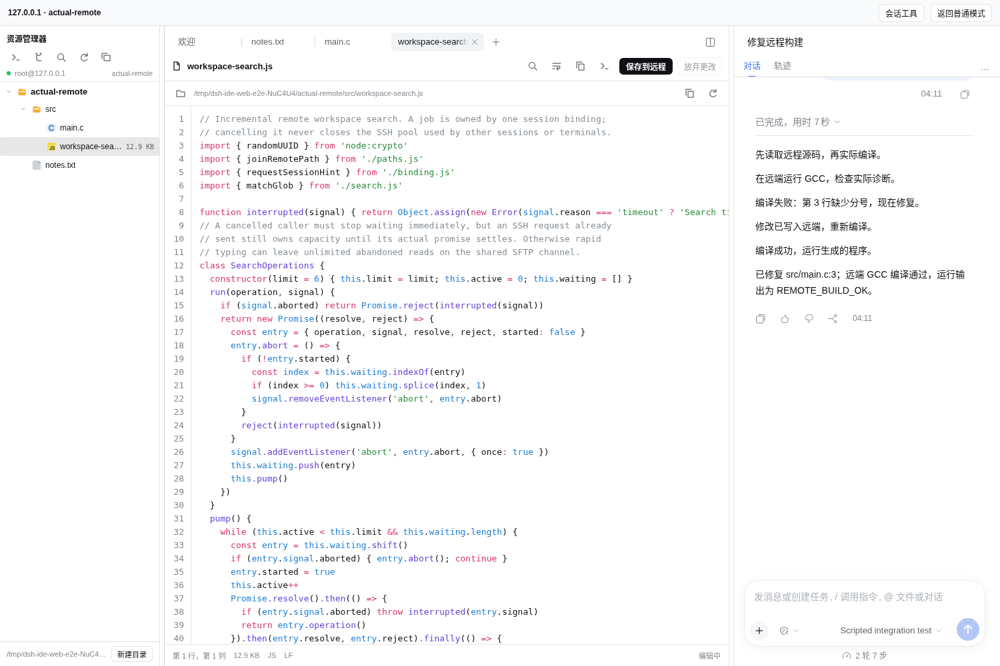
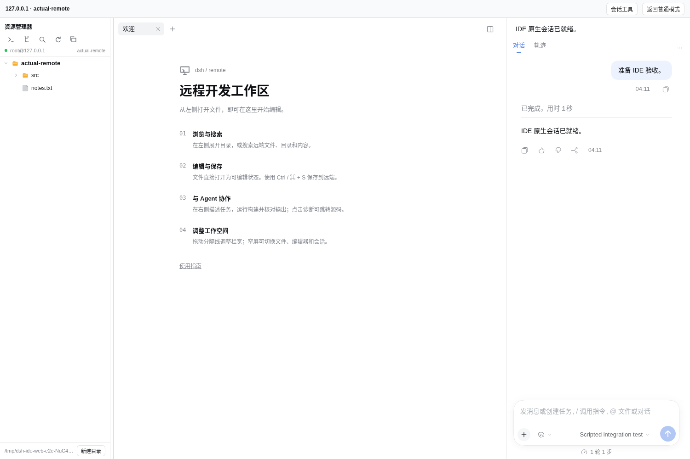

# 1.1.2 IDE 编辑与 Agent 文件读取

- IDE 初次进入与关完文件后显示欢迎页；左边保留远程文件树，中间不再出现重复文件树或宿主“开始”卡片。
- 文本文件打开即可编辑，保留语法高亮、行号、查找、换行、缩进、中文输入与原生撤销。保存后留在当前编辑器，放弃更改恢复基线。
- Markdown 默认源码，可显式预览；图片、二进制及截断文件继续只读。未知语法使用普通文本，大文件采用轻量回退。
- 右栏默认只显示标题、原生菜单和视图；额外动作与连接信息通过顶栏“会话工具”展开。窄栏中取消宿主负边距并允许必要的换行，正文位于完整头部之后。
- 保留的文件编辑节点在重新显示时重查远端；不丢草稿，并检测外部变化。

- Agent 普通文件工具误写本地镜像时，不再把成功的本地写入当成远端文件已存在。远程会话引导使用远程写入工具；历史本地副本可显式只读查看，确认后独占创建远端文件，保留原始字节并拒绝版本变化和覆盖。权限错误不会切换到本地内容。修复工作区写入权限对相对路径与本地镜像路径的误判，权限检查与实际写入使用相同路径解析。

验证使用 DSH Web 0.2.1-rc.5 与 0.2.2-rc.1、隔离临时 profile、loopback SSH/SFTP 与真实 Chromium。IDE 压力场景包含长标题、多 Agent、多工具、280/360/400px 右栏、原生弹层以及持续运行的 GCC 任务。编辑组件使用真实宿主高亮和主题，覆盖选区、滚动、换行、撤销、IME 和大文件。

沿用 [1.1.1 的能力边界](1.1.1.md)：不提供远端语言服务、扩展宿主或调试器；草稿保存在当前页面内存，强制退出仍可能丢失。保存使用乐观冲突检查。Windows 原生 GUI 和用户公网主机不计入本次浏览器验收。
